<!-- _class: lead -->


# IPD434
## Redes neuronales
### De evaluación de datos a arquitecturas profundas

Dr. Patricio Olivares Roncagliolo

---

## Conexión con el curso

- Los sistemas difusos codifican conocimiento mediante membresías y reglas.
- Los algoritmos evolutivos buscan soluciones mediante poblaciones.
- Las redes neuronales ajustan parámetros a partir de ejemplos.

$$
\mathcal D=\{(x_i,y_i)\}_{i=1}^{n}
\xrightarrow{\text{entrenamiento}}
f_\theta(x)
$$

<div class="bridge">
El modelo aprende regularidades de los datos. No aprende automáticamente el objetivo real ni corrige un diseño experimental deficiente.
</div>

---

## Objetivos de la unidad

Al finalizar se espera poder:

1. **Formular** tareas de clasificación y regresión.
2. **Separar** entrenamiento, validación y prueba sin fuga de información.
3. **Seleccionar** métricas coherentes con el costo de los errores.
4. **Explicar** perceptrón, descenso de gradiente y retropropagación.
5. **Diseñar** una red multicapa con regularización.
6. **Distinguir** cuándo utilizar capas densas, recurrentes o convolucionales.

---

## Ruta de la clase

1. Definimos la tarea, los datos y el costo de equivocarse.
2. Separamos los datos y elegimos métricas antes de entrenar.
3. Construimos desde el perceptrón hasta una red multicapa.
4. Explicamos cómo descenso de gradiente y retropropagación ajustan sus parámetros.
5. Controlamos el sobreajuste y elegimos una arquitectura acorde con la estructura de los datos.
6. Cerramos con un protocolo de evaluación reproducible.

---

## Aprendizaje Automático

El aprendizaje automático (*Machine Learning*) reúne métodos que ajustan un modelo a partir de ejemplos para producir predicciones o decisiones sobre observaciones nuevas.

<div class="callout">
Aprender significa capturar regularidades de los datos para generalizar a observaciones que todavía no hemos visto.
</div>

---

## Aprendizaje Automático

<div class="diagram-focus">
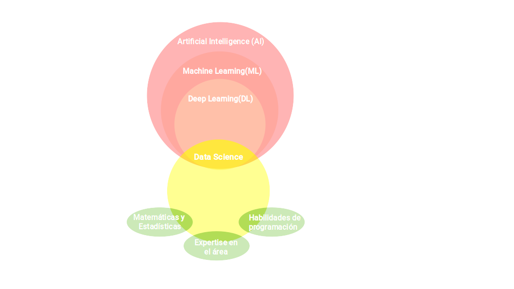
</div>

---

## ¿Cuándo usar aprendizaje automático?

<div class="columns">
<div>

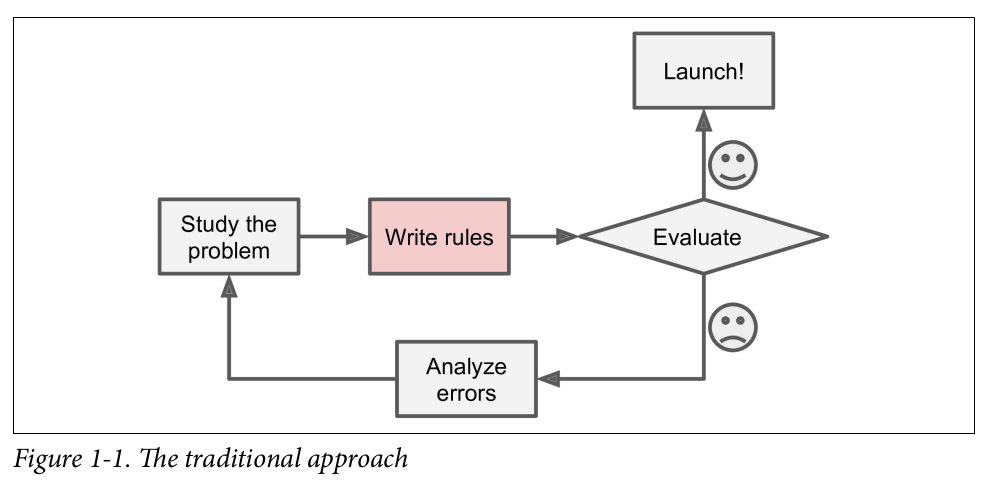

**Programación explícita**

Se debe anticipar los patrones, escribir las reglas y mantener sus excepciones.

</div>
<div>

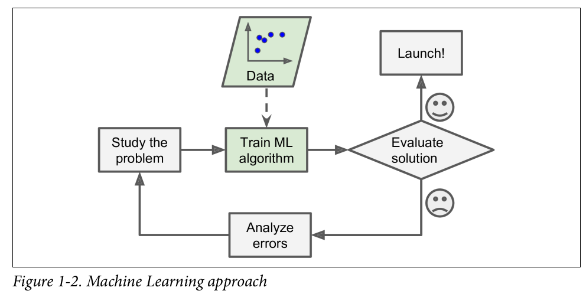

**Aprendizaje desde ejemplos**

Un modelo ajusta sus parámetros para capturar regularidades presentes en los datos.

</div>
</div>

Qué solución usar depende de si existe una regla simple que permita resolver el problema, o si los datos disponibles permiten obtener una relación generalizable.

---

## Bibliotecas de Aprendizaje Automático

<div class="columns">
<div>


</div>
<div>

- **NumPy y Pandas:** representar y preparar datos.
- **Scikit Learn:** modelos clásicos, particiones y métricas.
- **PyTorch:** construir y entrenar redes neuronales.

</div>
</div>

<div class="bridge">
La biblioteca facilita el trabajo, pero la tarea, los datos y la métrica siguen siendo decisiones de diseño.
</div>

---

## Scikit Learn

Scikit Learn es una biblioteca de Python para aprendizaje automático. Incluye modelos de clasificación y regresión, herramientas para preparar datos y métricas para evaluar resultados.

<div class="columns">
<div>

**Instalación**

```bash
pip install -U scikit-learn
```

</div>
<div>

**Enlaces**

[Sitio oficial](https://scikit-learn.org/stable/)<br>
[Guía de instalación](https://scikit-learn.org/stable/install.html)

</div>
</div>

<div class="bridge">
Con la biblioteca instalada, el trabajo se organiza en objetos con responsabilidades distintas.
</div>

---

## Scikit Learn

Una ventaja de Scikit Learn es la consistencia de su API: sus objetos siguen convenciones comunes y separan sus responsabilidades.

| Objeto | Responsabilidad | Método típico |
|---|---|---|
| Estimador | Ajustar parámetros | `fit(X, y)` |
| Transformador | Cambiar la representación | `fit` y `transform` |
| Predictor | Producir salidas | `predict(X)` |

Un flujo típico encadena: **ajustar con entrenamiento → transformar sin volver a ajustar → predecir sobre datos nuevos**.

Así, podemos cambiar de modelo sin rehacer toda la lógica experimental: `fit` ajusta, `transform` transforma y `predict` predice.

---

## Tipos de Aprendizaje Automático

Los paradigmas se distinguen por la información que guía el aprendizaje.

| Tipo | Información disponible | Qué busca el modelo | Ejemplo |
|---|---|---|---|
| Supervisado | Entradas con objetivo conocido | Predecir el objetivo de un caso nuevo | Estimar consumo eléctrico desde mediciones históricas |
| No supervisado | Datos sin objetivo | Encontrar grupos o estructura | Agrupar usuarios según su patrón de uso |
| Semisupervisado | Pocas etiquetas y muchos datos sin etiqueta | Aprovechar ambos conjuntos | Clasificar imágenes médicas con pocas etiquetas |
| Por refuerzo | Estados, acciones y recompensas | Elegir acciones con mayor retorno | Controlar el uso de energía de un sistema |

---

## Aprendizaje Supervisado

Cada ejemplo de entrenamiento contiene una entrada y su objetivo conocido:

$$
\mathcal D=\{(x_i,y_i)\}_{i=1}^{n}
$$

El modelo ajusta sus parámetros para que, dada una entrada nueva $x$, su predicción $f_\theta(x)$ se aproxime al objetivo esperado $y$.

<div class="bridge">
La forma del objetivo y define la tarea. Puede representar una categoría o una cantidad.
</div>

---

## Tipos de Aprendizaje Supervisado

El objetivo $y$ determina qué debe predecir el modelo.

| Tarea | Forma del objetivo | Pregunta | Ejemplos |
|---|---|---|---|
| Clasificación | Categoría o etiqueta | ¿A qué clase pertenece? | Detectar una falla, filtrar spam, identificar una prenda |
| Regresión | Cantidad numérica | ¿Qué valor se espera? | Estimar consumo eléctrico, precio o temperatura |

Esta diferencia define la salida del modelo, la función de pérdida y la métrica de evaluación.

---

## Clasificación: predecir una categoría

Cada objetivo pertenece a una de $K$ clases posibles:

$$
f_\theta:\mathbb R^d\rightarrow\{1,\dots,K\}
$$

- **Clasificación binaria:** dos clases posibles, por ejemplo `falla` y `sin falla`.
- **Clasificación con varias clases:** una clase entre varias posibles, como `manzana`, `plátano` o `naranja`.

<div class="example-space">
Un filtro de correo puede clasificar un mensaje como "spam" o "no spam". El objetivo es asignar una etiqueta, no medir una cantidad.
</div>

---

## Regresión: predecir una cantidad

El objetivo es un valor numérico continuo, o un vector de valores:

$$
f_\theta:\mathbb R^d\rightarrow\mathbb R^m
$$

Por ejemplo, un modelo puede estimar el consumo eléctrico de la próxima hora en kWh, la temperatura de un equipo en $^\circ\mathrm{C}$ o el precio de una vivienda en millones.

<div class="example-space">
Un pronóstico de consumo de 120 kWh no pertenece a una clase. Debe compararse con el consumo real y el error conserva la unidad del problema.
</div>

---

## Componentes de un experimento supervisado


<div class="bridge">
La pérdida guía el ajuste de θ con los datos de entrenamiento. La validación permite elegir hiperparámetros y la prueba se reserva para reportar el desempeño final.
</div>

---

## Protocolo de entrenamiento y evaluación supervisada

La salida $\hat y$ define si la tarea es clasificación o regresión. El protocolo experimental define cómo se ajusta el modelo y cómo se estima su desempeño fuera de los datos usados para decidir.

| Componente | Rol formal | Se desarrolla en |
|---|---|---|
| Parámetros $\theta$ y pérdida $\ell$ | Ajustar el modelo con entrenamiento | Pérdida promedio |
| Datos y preprocesamiento | Preservar la información disponible sin fuga | Particiones y preprocesamiento |
| Hiperparámetros $\mathcal H$ | Elegir una configuración con validación | Selección de modelos |
| Métricas | Cuantificar la calidad de las predicciones | Evaluación de clasificación y regresión |

---

## Cómo se ajustan los parámetros del modelo

Sea $\mathcal D_{\mathrm{train}}=\{(x_i,y_i)\}_{i=1}^{n_{\mathrm{train}}}$. Cada ejemplo produce un error mediante la pérdida $\ell(\hat y,y)$.

$$
\widehat L_{\mathrm{train}}(\theta)
=\frac{1}{n_{\mathrm{train}}}\sum_{i=1}^{n_{\mathrm{train}}}
\ell\big(f_\theta(x_i),y_i\big)
$$

El entrenamiento resume los errores individuales en una pérdida promedio y busca los parámetros que la minimizan:

$$
\hat\theta=\arg\min_\theta \widehat L_{\mathrm{train}}(\theta)
$$

Esta optimización responde cuánto se equivoca el modelo en los ejemplos disponibles para aprender. Un error bajo allí no garantiza un buen desempeño en ejemplos nuevos.

---

## Parámetros e hiperparámetros en el aprendizaje

Los **parámetros** son valores internos que el modelo aprende, como pesos y sesgos.
Los **hiperparámetros** configuran el modelo y su entrenamiento, como arquitectura, tasa de aprendizaje, tamaño de lote y regularización.

$\mathcal A_{\mathbf h}$ es el procedimiento de entrenamiento definido por $\mathbf h$. Usa $\mathcal D_{\mathrm{train}}$ para calcular gradientes y actualizar los parámetros.

$$
\hat\theta(\mathbf h)=\mathcal A_{\mathbf h}\big(\mathcal D_{\mathrm{train}}\big)
$$

$\hat\theta(\mathbf h)$ son los parámetros finales aprendidos con esa configuración.

---

## Selección de hiperparámetros mediante validación

Cada configuración $\mathbf h$ produce una función entrenada $f_{\hat\theta(\mathbf h)}$, definida por los parámetros obtenidos. La validación permite comparar esas funciones sin usar todavía el conjunto de prueba:

$$
\mathbf h^*=\arg\min_{\mathbf h\in\mathcal H}
\widehat L_{\mathrm{val}}\big(\hat\theta(\mathbf h)\big)
$$

- $\mathcal H$: conjunto de configuraciones candidatas.
- $\widehat L_{\mathrm{val}}$: pérdida promedio calculada sobre validación.
- $\mathbf h^*$: configuración cuyo modelo obtiene la menor pérdida de validación.

La prueba se reserva para estimar el desempeño final de la configuración seleccionada.

---

## Particiones para ajuste, selección y evaluación

El conjunto de datos se divide en subconjuntos disjuntos:

$$
\mathcal D=\mathcal D_{\mathrm{train}}\dot\cup
\mathcal D_{\mathrm{val}}\dot\cup
\mathcal D_{\mathrm{test}}
$$

| Partición | Uso | ¿Ajusta decisiones? |
|---|---|---|
| Entrenamiento | Estimar parámetros | Sí |
| Validación | Elegir hiperparámetros y detener | Sí |
| Prueba | Estimar desempeño final | No |

<div class="warn">
Preprocesar con estadísticas calculadas sobre todos los datos, seleccionar modelos mirando prueba o duplicar muestras entre particiones produce fuga de información.
</div>

---

## Porcentajes habituales de partición

Los porcentajes son orientativos. Elija la proporción según el tamaño de los datos y la precisión necesaria.

| Estructura | Proporción | Cuándo usarla |
|---|---:|---|
| Entrenamiento / prueba | 80  / 20 | Caso general o validación cruzada |
| Entrenamiento / prueba | 70 / 30 o 60 / 40 | Dataset grande con prueba más estable |
| Entrenamiento / validación / prueba | 80 / 10 / 10 | Ajuste moderado de parámetros |
| Entrenamiento / validación / prueba | 70 / 15 / 15 | Dataset grande o muchas configuraciones |
| Entrenamiento / validación / prueba | 90 / 5 / 5 | Dataset muy grande. El 5% debe bastar para validar y probar |

---

## Preprocesamiento

Un transformador, por ejemplo un escalador o codificador, debe estimarse **únicamente** en $\mathcal D_{\mathrm{train}}$:

$$
\widehat T=\operatorname{fit}(X_{\mathrm{train}}),
\qquad
X_s'=\widehat T(X_s),
\quad
s\in\{\mathrm{train},\mathrm{val},\mathrm{test}\}
$$

Esto permite aplicar la misma representación a cada partición sin incorporar información de validación o prueba durante el ajuste.

---

## Secuencia de selección y prueba final

1. **Dividir** los datos respetando grupos, tiempo y clases cuando corresponda.
2. **Ajustar** el preprocesamiento solo con entrenamiento.
3. **Transformar** entrenamiento, validación y prueba con esos mismos parámetros.
4. **Seleccionar** arquitectura e hiperparámetros usando validación.
5. **Evaluar** la prueba una sola vez al final.

---

## Métricas de evaluación

Una métrica resume la calidad de las predicciones comparando los objetivos reales $y$ con las predicciones $\hat y$:

$$
M\big(\mathbf y,\hat{\mathbf y}\big)\in\mathbb R
$$

La métrica debe responder a la decisión que se quiere apoyar. Por eso importa:

- qué error se considera relevante
- si las clases están desbalanceadas
- qué unidades tiene el objetivo
- qué costo tiene equivocarse

Una misma predicción puede parecer buena o mala según la métrica utilizada.

---

## Métricas para clasificación

En clasificación, la predicción es una etiqueta o un puntaje que luego se convierte en etiqueta mediante un umbral.

En clasificación binaria, la calidad del modelo se describe contando aciertos y errores: verdaderos positivos (TP), verdaderos negativos (TN), falsos positivos (FP) y falsos negativos (FN).

---

## Clasificación binaria: aciertos y errores

Supongamos que la clase positiva representa la condición que queremos detectar:

| Resultado | Condición real | Predicción | Interpretación | Ejemplo |
|---|---|---|---|---|
| $TP$ | Positiva | Positiva | Acierto al detectar la condición | esto es 5 |
| $TN$ | Negativa | Negativa | Acierto al descartar la condición | esto no es 5 |
| $FP$ | Negativa | Positiva | Falsa alarma | esto no es 5 |
| $FN$ | Positiva | Negativa | Omisión de un caso real | esto es 5 |

El significado de "positivo" depende de la decisión. No tiene por qué corresponder a la clase más frecuente.

---

## Matriz de confusión binaria

Una matriz de confusión cruza la clase real con la clase predicha y cuenta cuántos casos caen en cada combinación.

En clasificación binaria, sus cuatro celdas corresponden a $TP$, $TN$, $FP$ y $FN$. Así permite observar por separado los aciertos y los tipos de error.

---

## Matriz de confusión binaria

<div class="matrix-focus">
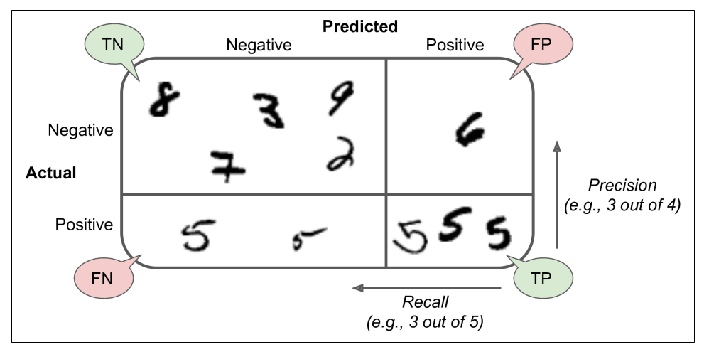
</div>

---

## Cómo leer una matriz de confusión

La matriz cruza dos perspectivas sobre los mismos casos:

- **Filas:** condición real observada.
- **Columnas:** clase predicha por el modelo.
- **Diagonal:** aciertos $TP$ y $TN$.
- **Fuera de la diagonal:** errores $FP$ y $FN$.

La matriz conserva los conteos necesarios para calcular exactitud, precisión, exhaustividad y especificidad. La importancia de cada celda depende del problema.

---

## Cálculo de métricas a partir de una matriz de confusión

El notebook [04_clasificacion_titanic.ipynb](notebook/04_clasificacion_titanic.ipynb) reproduce el cálculo sobre el dataset [Titanic: Machine Learning from Disaster](https://www.kaggle.com/competitions/titanic/data). Sobre sus 179 casos de prueba:

| | Predice positivo | Predice negativo |
|---|---:|---:|
| Real positivo | $TP=59$ | $FN=17$ |
| Real negativo | $FP=16$ | $TN=87$ |

- Exactitud: $(59+87)/179=81{,}6\%$.
- Precisión: $59/(59+16)=78{,}7\%$.
- Exhaustividad: $59/(59+17)=77{,}6\%$.

La misma matriz puede verse "bien" o "mal" según qué error sea más costoso.

---

## Exactitud

**Exactitud (*accuracy*)**

Aciertos sobre el total de casos:

$$
\operatorname{Acc}=\frac{TP+TN}{TP+TN+FP+FN}
$$

- ¿Qué proporción del total fue clasificada correctamente?
- Usar cuando las clases y los costos de error son similares.

---

## Especificidad

**Especificidad (*specificity*, TNR)**

Negativos reales reconocidos correctamente:

$$
\operatorname{Esp}=\frac{TN}{TN+FP}
$$

- ¿Qué proporción de los negativos reales fue descartada correctamente?
- Usar cuando importa no marcar como positivos los negativos reales y una falsa alarma $FP$ resulta costosa.

---

## Precisión

**Precisión (*precision*, PPV)**

Positivos reales entre las predicciones positivas:

$$
\operatorname{Prec}=\frac{TP}{TP+FP}
$$

- ¿Cuántos casos marcados como positivos eran realmente positivos?
- Usar cuando una falsa alarma $FP$ es costosa en relación con omitir positivos.

---

## Exhaustividad

**Exhaustividad (*recall*, sensibilidad, TPR)**

Positivos reales detectados por el modelo:

$$
\operatorname{Rec}=\frac{TP}{TP+FN}
$$

- ¿Cuántos positivos reales fueron detectados?
- Usar cuando una omisión $FN$ es costosa en relación con generar falsas alarmas.

---

## Limitaciones de las métricas

Consideremos 20 números: 3 son 5 y 17 no son 5.

El modelo "nada es 5" predice "no es 5" para todos los casos:

$$
TP=0,\qquad TN=17,\qquad FP=0,\qquad FN=3
$$

Su exactitud es:

$$
\operatorname{Acc}=\frac{0+17}{20}=85\%
$$

El valor parece alto, pero el modelo no detecta ninguno de los tres cincos.

---

## Limitaciones de las métricas

Para el modelo "nada es 5", las otras métricas muestran un comportamiento muy diferente:

$$
\operatorname{Rec}=\frac{0}{0+3}=0,
\qquad
\operatorname{Esp}=\frac{17}{17+0}=1
$$

La precisión es indefinida porque el modelo no predice ningún positivo. Una biblioteca puede aplicar una convención configurable para evitar esta división por cero:

$$
\operatorname{Prec}=\frac{0}{0+0}=\frac{0}{0}
$$

La exactitud está dominada por la clase mayoritaria. Por eso debemos examinar qué tipo de acierto o error importa en el problema.

---

## $F_1$: equilibrio entre precisión y exhaustividad

$$
F_1=2\frac{\operatorname{Prec}\cdot\operatorname{Rec}}
{\operatorname{Prec}+\operatorname{Rec}}
$$

El $F_1$ es la media armónica de precisión y exhaustividad.

- Solo es alto cuando ambas métricas son altas.
- Es útil cuando precisión y exhaustividad tienen una importancia comparable.

---

## Curva ROC: interpretación de sus ejes

La curva ROC muestra cómo cambia el desempeño de un clasificador al modificar el umbral aplicado a su puntaje:

$$
\operatorname{TPR}=\frac{TP}{TP+FN},
\qquad
\operatorname{FPR}=\frac{FP}{FP+TN}
$$

- **Eje vertical:** TPR o sensibilidad, proporción de positivos reales detectados.
- **Eje horizontal:** FPR, proporción de negativos reales clasificados erróneamente como positivos.
- **Cada punto:** una regla de decisión distinta, con un compromiso entre detección y falsas alarmas.
- **Interpretación:** el punto ideal es $(0,1)$. La diagonal representa un clasificador equivalente al azar.

---

## Curva ROC y ROC AUC


El ejemplo muestra un clasificador cuya curva se encuentra por encima del azar. 
[Visualización interactiva de una curva ROC](http://www.navan.name/roc/)

---

## Métricas para regresión

En regresión, la predicción es una **cantidad numérica**. Las métricas comparan $y$ y $\hat y$ mediante una noción de distancia o variación explicada.

---

## MAE: Mean Absolute Error

$$
MAE=\frac{1}{n}\sum_{i=1}^{n}|y_i-\hat y_i|
$$

El MAE es el error absoluto promedio. Cada unidad de error contribuye de la misma forma, sin importar si la predicción quedó por encima o por debajo del valor real.

- Usarlo cuando se necesita una medida directa e interpretable en las unidades del objetivo.
- Es menos sensible a valores extremos que las métricas cuadráticas.

---

## MSE: Mean Square Error

$$
MSE=\frac{1}{n}\sum_{i=1}^{n}(y_i-\hat y_i)^2
$$

El MSE eleva cada error al cuadrado. Por eso un error grande pesa mucho más que varios errores pequeños.

- Usarlo cuando los errores grandes son especialmente costosos o deben penalizarse con fuerza.
- Su unidad queda elevada al cuadrado y es sensible a valores extremos.

---

## RMSE: Root Mean Square Error

$$
RMSE=\sqrt{MSE}
$$

El RMSE conserva las unidades de la variable objetivo y resume la magnitud típica del error, dando más peso a las desviaciones grandes.

- Usarlo cuando se quiere relacionar el desempeño con una tolerancia operacional.
- Mantiene la sensibilidad del MSE frente a valores extremos.

---

## $R^2$: comparación con una línea base

El coeficiente de determinación compara el error cuadrático del modelo con el de predecir siempre la media del conjunto evaluado:

$$
R^2=1-\frac{\sum_i(y_i-\hat y_i)^2}{\sum_i(y_i-\bar y)^2}
$$

$R^2=1$ indica ajuste perfecto. $R^2=0$ corresponde al predictor constante $\bar y$ en ese conjunto evaluado. Un valor negativo indica que el modelo rinde peor que esa línea base.

- Usarlo para comparar cuánto mejora el modelo respecto de una referencia simple.
- Complementarlo con MAE o RMSE para conocer el error en las unidades originales.

---

## Modelos predictivos supervisados

Un modelo predictivo aprende una función parametrizada a partir de datos etiquetados:

$$
f_\theta:\mathcal X\longrightarrow\mathcal Y,
\qquad
\hat y=f_\theta(\mathbf x)
$$

Los parámetros $\theta$ se ajustan con entrenamiento y luego se evalúan sobre datos no vistos.

- **Clasificación:** $\mathcal Y$ contiene etiquetas discretas.
- **Regresión:** $\mathcal Y\subseteq\mathbb R^m$ contiene valores numéricos.

La tarea fija el tipo de salida, la función de pérdida y las métricas de evaluación.

---

## Ejemplos de modelos predictivos en Scikit Learn

<div class="columns">
<div>

**Clasificación**

- Regresión logística: [`LogisticRegression`](https://scikit-learn.org/stable/modules/generated/sklearn.linear_model.LogisticRegression.html)
- KNN: [`KNeighborsClassifier`](https://scikit-learn.org/stable/modules/generated/sklearn.neighbors.KNeighborsClassifier.html)
- Árboles y bosques: [`DecisionTreeClassifier`](https://scikit-learn.org/stable/modules/generated/sklearn.tree.DecisionTreeClassifier.html), [`RandomForestClassifier`](https://scikit-learn.org/stable/modules/generated/sklearn.ensemble.RandomForestClassifier.html)
- Support Vector Machine Classifier: [`SVC`](https://scikit-learn.org/stable/modules/generated/sklearn.svm.SVC.html)

</div>
<div>

**Regresión**

- Modelos lineales: [`LinearRegression`](https://scikit-learn.org/stable/modules/generated/sklearn.linear_model.LinearRegression.html), [`Ridge`](https://scikit-learn.org/stable/modules/generated/sklearn.linear_model.Ridge.html), [`Lasso`](https://scikit-learn.org/stable/modules/generated/sklearn.linear_model.Lasso.html)
- KNN: [`KNeighborsRegressor`](https://scikit-learn.org/stable/modules/generated/sklearn.neighbors.KNeighborsRegressor.html)
- Árboles y ensambles: [`RandomForestRegressor`](https://scikit-learn.org/stable/modules/generated/sklearn.ensemble.RandomForestRegressor.html), [`GradientBoostingRegressor`](https://scikit-learn.org/stable/modules/generated/sklearn.ensemble.GradientBoostingRegressor.html)
- Support Vector Machine Regressor: [`SVR`](https://scikit-learn.org/stable/modules/generated/sklearn.svm.SVR.html)

</div>
</div>

---

## Modelo de regresión lineal

Consideremos $m$ ejemplos de entrenamiento y $N$ características por ejemplo. Para incorporar el intercepto, definimos $x_0^{(i)}=1$:

$$
h_\theta\big(x^{(i)}\big)
=\sum_{j=0}^{N}\theta_jx_j^{(i)}
=\theta_0+\sum_{j=1}^{N}\theta_jx_j^{(i)}
$$

- $\theta_0$ es el intercepto y $\theta_j$ es el peso de la característica $j$.
- $i=1,\ldots,m$ identifica el ejemplo y $j=1,\ldots,N$ la característica.

El modelo es lineal en los parámetros, aunque las características pueden provenir de transformaciones no lineales.

---

## Mínimos cuadrados ordinarios

El entrenamiento busca los valores de $\theta_0,\ldots,\theta_N$ que minimizan el error cuadrático promedio:

$$
\operatorname{MSE}(\theta)
=\frac{1}{m}\sum_{i=1}^{m}
\left(h_\theta\big(x^{(i)}\big)-y^{(i)}\right)^2
$$

$$
\hat\theta_0,\ldots,\hat\theta_N
=\underset{\theta_0,\ldots,\theta_N}{\operatorname{argmin}}
\operatorname{MSE}(\theta)
$$

Cada residuo $h_\theta(x^{(i)})-y^{(i)}$ mide el error de un ejemplo. Elevarlo al cuadrado penaliza más las desviaciones grandes.

---

## Condición de óptimo en mínimos cuadrados

La derivada parcial respecto de cada parámetro es:

$$
\frac{\partial\operatorname{MSE}(\theta)}{\partial\theta_j}
=\frac{2}{m}\sum_{i=1}^{m}
\left(h_\theta\big(x^{(i)}\big)-y^{(i)}\right)x_j^{(i)},
\qquad j=0,\ldots,N
$$

En el mínimo, todas las derivadas se anulan. Por tanto, los parámetros satisfacen las ecuaciones normales escalares:

$$
\sum_{i=1}^{m}
\left(h_\theta\big(x^{(i)}\big)-y^{(i)}\right)x_j^{(i)}=0,
\qquad j=0,\ldots,N
$$

Estas ecuaciones forman un sistema de $N+1$ ecuaciones para $\theta_0,\ldots,\theta_N$. Resolverlo entrega los parámetros que minimizan el MSE.

---

## Descenso de gradiente en regresión lineal

También podemos ajustar cada parámetro mediante actualizaciones iterativas:

$$
\theta_j\leftarrow\theta_j-
\eta\frac{\partial\operatorname{MSE}(\theta)}{\partial\theta_j},
\qquad j=0,\ldots,N
$$

- $\eta>0$ es la tasa de aprendizaje.
- El gradiente indica cómo cambia el MSE al modificar cada parámetro.

La misma regla se extenderá a redes neuronales, donde no existe en general una solución cerrada.

---

## Redes Neuronales

Las redes neuronales son una familia de modelos paramétricos ampliamente utilizada para aprender relaciones complejas y generar nuevas salidas a partir de patrones aprendidos.

- **Predicción:** clasificación de imágenes, recomendación, pronóstico y detección de anomalías.
- **Modelos generativos:** creación de texto, imágenes, audio, video y código.
- **LLM:** modelos de lenguaje a gran escala que permiten asistentes como ChatGPT, Claude y otros sistemas conversacionales.

<div class="bridge">
La misma idea de apilar unidades simples permite construir modelos predictivos y generativos.
</div>

---

## Ejemplos de aplicaciones de Redes Neuronales

- [DeepMind](https://www.youtube.com/watch?v=V1eYniJ0Rnk): juegos y estrategia
- [YOLOv3](https://www.youtube.com/watch?v=MPU2HistivI): detección de objetos
- [Quick, Draw!](https://quickdraw.withgoogle.com/): reconocimiento de dibujos
- [Piedra, papel o tijera](https://tenso.rs/demos/rock-paper-scissors/): reconocimiento de gestos
- [ChatGPT](https://chat.openai.com/): generación de texto
- [Y una laaaaarga lista](https://www.mygreatlearning.com/blog/deep-learning-applications/#deepdreaming)

---

## Redes Neuronales: El Perceptrón

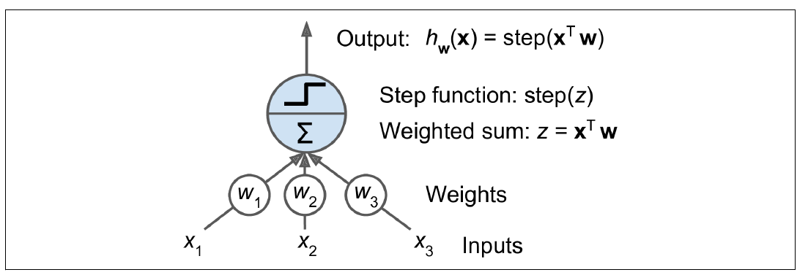

---

## Redes Neuronales: El Perceptrón

$$
z=w_0+\sum_{j=1}^{N}w_jx_j,
\qquad
\hat y=\operatorname{step}(z)
$$

La función escalón convierte el puntaje en una etiqueta binaria:

$$
\operatorname{step}(z)=
\begin{cases}
0, & z<0\\
1, & z\geq 0
\end{cases}
$$

Los pesos definen la orientación de la frontera y $w_0$ la desplaza. Una sola unidad solo puede separar clases linealmente separables.


---

## Regresión lineal y perceptrón

Ambos modelos calculan una combinación afín de las características. Cambian la interpretación de la salida:

| Aspecto | Regresión lineal | Perceptrón |
|---|---|---|
| Puntaje | $h_\theta(x)=\theta_0+\sum_{j=1}^{N}\theta_jx_j$ | $z=w_0+\sum_{j=1}^{N}w_jx_j$ |
| Salida | $\hat y=h_\theta(x)\in\mathbb R$ | $\hat y=\mathbb I\{z\geq0\}\in\{0,1\}$ |
| Tarea | Predecir una cantidad | Separar dos clases |
| Ajuste habitual | MSE | Criterio del perceptrón o pérdida de clasificación |
| Geometría | Hiperplano de predicción | Hiperplano como frontera de decisión |

Una sigmoide aplicada al puntaje produce una probabilidad diferenciable. Con entropía cruzada se obtiene regresión logística, una conexión directa con las redes neuronales.

---

## Red neuronal multicapa

El perceptrón construye una sola frontera lineal. Una red multicapa encadena unidades para construir representaciones intermedias antes de producir la salida.

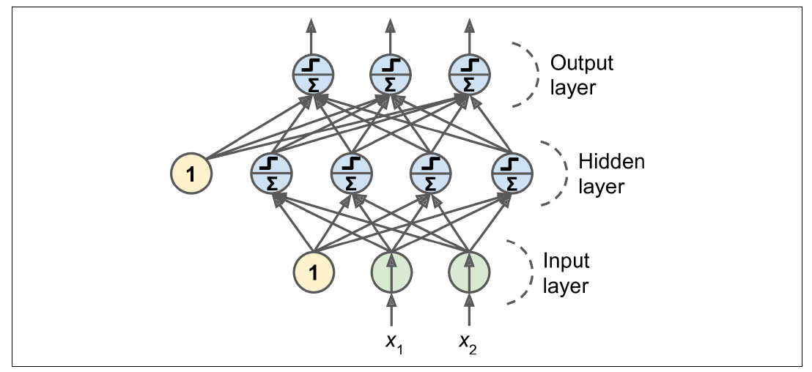

---

## Red neuronal multicapa

- La **arquitectura** describe cuántas capas y unidades tiene la red, y cómo están conectadas.
- Una red con una o más capas ocultas es una red multicapa.
- Cuando hay muchas capas ocultas, se habla de una red profunda.

<div class="bridge">
Primero identificamos las capas y sus conexiones. Luego veremos por qué cada capa necesita una activación no lineal.
</div>

---

## Tipos de capas

| Capa | Rol | Características |
|---|---|---|
| Entrada | Recibe la representación de cada ejemplo | Tiene una unidad por característica. No transforma los datos por sí misma. |
| Oculta | Construye representaciones internas | Aplica pesos, sesgos y una activación. Puede haber una o varias. |
| Salida | Produce la predicción final | Su tamaño y activación dependen de la tarea. |

Para una imagen, la entrada puede contener píxeles. Para datos tabulares, puede contener variables como edad, consumo o temperatura.

---

## Capas densas: conexiones y cálculo

En una capa densa, cada unidad de una capa se conecta con todas las unidades de la capa siguiente. Cada conexión tiene un peso aprendido.

$$
\mathbf z^{(\ell)}=\mathbf W^{(\ell)}\mathbf a^{(\ell-1)}+\mathbf b^{(\ell)},
\qquad
\mathbf a^{(\ell)}=g^{(\ell)}\big(\mathbf z^{(\ell)}\big)
$$

- $\mathbf a^{(0)}=\mathbf x$ es el vector de entrada.
- $\mathbf W^{(\ell)}$ contiene los pesos entre las capas $\ell-1$ y $\ell$.
- $\mathbf b^{(\ell)}$ contiene un sesgo por unidad de la capa $\ell$.
- $g^{(\ell)}$ es la función de activación aplicada a cada componente.

---

## Red multicapa: composición de capas no lineales

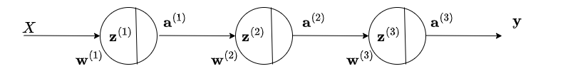

Para la capa $\ell$, una combinación afín seguida de una activación produce una nueva representación:

$$
\mathbf z^{(\ell)}=W^{(\ell)}\mathbf a^{(\ell-1)}+\mathbf b^{(\ell)},
\qquad
\mathbf a^{(\ell)}=\phi^{(\ell)}(\mathbf z^{(\ell)})
$$

Componer transformaciones lineales con activaciones no lineales permite representar fronteras complejas. Sin esa no linealidad, varias capas densas seguidas se reducen algebraicamente a una sola transformación lineal.

---

## Profundidad y ancho

- **Profundidad:** número de capas ocultas. Aumentarla permite construir representaciones en varios niveles.
- **Ancho:** número de unidades en una capa. Afecta la cantidad de patrones que la capa puede representar.
- **Parámetros:** cada conexión y cada sesgo se ajustan durante el entrenamiento.

Más capas o más unidades aumentan la capacidad del modelo, pero también el costo de entrenamiento y el riesgo de sobreajuste. La arquitectura se selecciona con validación.

---

## Función de activación

Una función de activación transforma el puntaje $z$ de una unidad en su salida $a$:

$$
z=\mathbf w^\top\mathbf x+b,
a=g(z)
$$

Su función principal es introducir no linealidad. Sin activaciones no lineales, varias capas densas seguidas se reducen a una sola transformación lineal.

<div class="callout">
La activación de las capas ocultas permite representar relaciones que un perceptrón o una regresión lineal no pueden capturar por sí solos.
</div>

---

## Activaciones lineal y ReLU

<div class="columns">
<div>

### Lineal

$$g(z)=z$$

- Conserva el puntaje sin limitar su rango.
- Es habitual en la salida de una tarea de regresión.
- No agrega capacidad de representación en capas ocultas.

</div>
<div>

### ReLU

$$g(z)=\max(0,z)$$

- Devuelve cero para puntajes negativos.
- Es una elección frecuente para capas ocultas.
- Una unidad puede quedar inactiva si recibe puntajes negativos de forma persistente.

</div>
</div>

---

## Leaky ReLU

Leaky ReLU conserva una pendiente pequeña cuando el puntaje es negativo:

$$
g(z)=
\begin{cases}
z, & z>0\\
\alpha z, & z\leq 0
\end{cases}
\qquad \alpha>0\text{ pequeño}
$$

- Es una variante de ReLU que reduce el riesgo de unidades inactivas.
- Para $z<0$, la salida y el gradiente no son exactamente cero.
- Se usa en capas ocultas cuando ReLU presenta muchas unidades inactivas.

---

## Sigmoide y tangente hiperbólica

<div class="columns">
<div>

### Sigmoide

$$\sigma(z)=\frac{1}{1+e^{-z}}$$

- Produce valores entre 0 y 1.
- En la salida binaria puede interpretarse como probabilidad.
- En capas ocultas puede producir gradientes muy pequeños para valores extremos.

</div>
<div>

### Tangente hiperbólica

$$\tanh(z)=\frac{e^z-e^{-z}}{e^z+e^{-z}}$$

- Produce valores entre $-1$ y $1$.
- Está centrada en cero.
- También puede saturarse para valores de gran magnitud.

</div>
</div>

---

## Softmax para varias clases

Para $K$ puntajes de salida $z_1,\ldots,z_K$, softmax produce una distribución de probabilidades:

$$
\operatorname{softmax}(\mathbf z)_k=
\frac{e^{z_k}}{\sum_{j=1}^{K}e^{z_j}}
$$

- Cada salida está entre 0 y 1.
- La suma de las $K$ salidas es 1.
- La clase predicha suele ser la de mayor probabilidad.

<div class="bridge">
Softmax se aplica en la capa de salida cuando hay varias clases mutuamente excluyentes.
</div>


---

## Funciones de activación: forma y rango

Cada gráfico relaciona el puntaje de entrada $z$ con la salida de la activación. En softmax, se muestra la probabilidad de una clase al variar su puntaje y mantener fijos los otros dos.

<div class="activation-grid">


</div>

---

## Funciones de activación: forma y rango

Cada gráfico relaciona el puntaje de entrada $z$ con la salida de la activación. En softmax, se muestra la probabilidad de una clase al variar su puntaje y mantener fijos los otros dos.

<div class="activation-grid">


</div>


---

## Selección de activación

| Ubicación o tarea | Elección habitual | Motivo |
|---|---|---|
| Capas ocultas | ReLU o Leaky ReLU | Introducen no linealidad y suelen facilitar el entrenamiento. |
| Salida de regresión | Lineal | Permite predecir valores sin restringir su rango. |
| Salida binaria | Sigmoide | Produce un puntaje entre 0 y 1. |
| Salida con varias clases | Softmax | Distribuye la probabilidad entre las clases. |

La activación se elige junto con la pérdida y la tarea. Por ejemplo, sigmoide y entropía cruzada binaria forman una combinación habitual.

---

## Salida, etiquetas y función de pérdida

| Tarea | Salida del modelo | Pérdida habitual |
|---|---|---|
| Regresión | Valor lineal $\hat y\in\mathbb R$ | MSE o MAE |
| Clasificación binaria | *Logit* o probabilidad sigmoide | Entropía cruzada binaria |
| Clasificación con varias clases | Vector de *logits* | Entropía cruzada para varias clases |

La codificación de etiquetas, la activación de salida y la pérdida deben ser compatibles. En PyTorch, `CrossEntropyLoss` recibe *logits* y aplica internamente la normalización necesaria.

---

## Entropía cruzada y *softmax* en clasificación con varias clases

Para una etiqueta con una sola clase activa $\mathbf y$ y probabilidades $\hat{\mathbf p}$:

$$
L=-\sum_{k=1}^{K}y_k\log\hat p_k
$$

con:

$$
\hat p_k=\frac{e^{z_k}}{\sum_j e^{z_j}}
$$

Minimizar esta pérdida aumenta la probabilidad asignada a la clase correcta y penaliza con fuerza las predicciones confiadas que resultan equivocadas. La clase predicha puede ser $\arg\max_k\hat p_k$, pero las probabilidades requieren calibración si se usarán para decisiones de riesgo.

---

## Descenso de gradiente sobre un mini lote

Una vez definidas la salida y la pérdida, el entrenamiento ajusta los pesos para reducir el error. En la práctica, el gradiente se estima con un mini lote $\mathcal B_t\subset\mathcal D_{\mathrm{train}}$:

$$
L_{\mathcal B_t}(\theta)
=\frac{1}{|\mathcal B_t|}\sum_{(x_i,y_i)\in\mathcal B_t}
\ell\big(f_\theta(x_i),y_i\big)
$$

$$
\theta_{t+1}=\theta_t-\eta\nabla_\theta L_{\mathcal B_t}(\theta_t)
$$

El gradiente indica el cambio local de la pérdida. La tasa $\eta$ controla el tamaño de cada actualización.

---

## Mini lotes, actualizaciones y épocas

- Un **mini lote** $\mathcal B_t$ produce una estimación estocástica del gradiente.
- Una **actualización** modifica $\theta$ una vez, después de procesar un mini lote.
- Una **época** recorre una vez todos los ejemplos de entrenamiento.

Una tasa de aprendizaje muy grande puede oscilar o divergir. Una muy pequeña avanza lentamente. El optimizador usa el gradiente para decidir cómo actualizar los parámetros.

---

## Optimizadores: SGD y Adam

Ambos convierten el gradiente de cada mini lote en una actualización de los pesos, pero lo hacen de manera distinta.

<div class="columns">
<div>

**SGD**

- Actualiza los pesos usando el gradiente del mini lote actual.
- Usa una tasa de aprendizaje común, $\eta$.
- Es simple y requiere poca memoria adicional.
- El resultado depende bastante de elegir una tasa adecuada.

</div>
<div>

**Adam**

- Mantiene promedios de los gradientes recientes y de sus cuadrados.
- Usa esos promedios para adaptar el tamaño del paso para cada parámetro.
- Suele ser un buen punto de partida y requiere más memoria que SGD.
- No garantiza el mejor desempeño: también se evalúa con validación.

</div>
</div>

Existen otros optimizadores, como RMSprop y Adagrad. En esta unidad nos enfocaremos en **SGD y Adam**.

---

## Feedforward paso a paso

Consideremos la red neuronal simple below:


La red tiene una sola neurona por capa:

- **Capa de entrada:** $z^{(1)}$ (1 neurona)
- **Capa oculta:** $z^{(2)}$ (1 neurona)
- **Capa de salida:** $z^{(3)}$ (1 neurona)

Conexiones: $z^{(1)} \xrightarrow{w^{(2)}} z^{(2)} \xrightarrow{w^{(3)}} z^{(3)}$

---

## Feedforward paso a paso

### Propagación hacia adelante

Para cada neurona calculamos:

$$z^{(l)} = h^{(l)}\big(z^{(l-1)} \cdot w^{(l)}\big)$$

donde $h^{(l)}$ es la función de activación de la capa $l$

#### Capa oculta

$$
z^{(2)} = h^{(2)}\big(z^{(1)} \cdot w^{(2)}\big)
$$

#### Capa de salida

$$
z^{(3)} = h^{(3)}\big(z^{(2)} \cdot w^{(3)}\big)
$$

---

## Backpropagation paso a paso

Supongamos una función de costo cuadrática:

$$
J = \big(a^{(3)} - y\big)^2
$$

donde $a^{(3)} = z^{(3)}$ es la salida de la red.

---

## Backpropagation paso a paso

### Paso 1: derivada respecto a $w^{(3)}$

Para actualizar $w^{(3)}$ usamos la regla de la cadena:

$$
\frac{\partial J}{\partial w^{(3)}}
= \frac{\partial z^{(3)}}{\partial w^{(3)}} \cdot
  \frac{\partial a^{(3)}}{\partial z^{(3)}} \cdot
  \frac{\partial J}{\partial a^{(3)}}
$$

Calculamos cada término:

$$
\begin{aligned}
\frac{\partial J}{\partial a^{(3)}} &= \frac{\partial}{\partial a^{(3)}} (a^{(3)} - y)^2 = 2(a^{(3)} - y) \\
\frac{\partial a^{(3)}}{\partial z^{(3)}} &= \frac{\partial}{\partial z^{(3)}} h^{(3)}(z^{(3)}) = \big(h^{(3)}\big)'(z^{(3)}) \\
\frac{\partial z^{(3)}}{\partial w^{(3)}} &= \frac{\partial}{\partial w^{(3)}} (a^{(2)} \cdot w^{(3)}) = a^{(2)}
\end{aligned}
$$

---

## Backpropagation paso a paso

Entonces:

$$
\frac{\partial J}{\partial w^{(3)}}
= a^{(2)} \cdot \big(h^{(3)}\big)'(z^{(3})) \cdot 2(a^{(3)} - y)
$$

---

## Backpropagation paso a paso

### Paso 2: derivada respecto a $w^{(2)}$

Para actualizar $w^{(2)}$ usamos la regla de la cadena:

$$
\frac{\partial J}{\partial w^{(2)}}
= \frac{\partial z^{(2)}}{\partial w^{(2)}} \cdot
  \frac{\partial a^{(2)}}{\partial z^{(2)}} \cdot
  \frac{\partial z^{(3)}}{\partial a^{(2)}} \cdot
  \boxed{\frac{\partial a^{(3)}}{\partial z^{(3)}} \cdot \frac{\partial J}{\partial a^{(3)}}}
$$

Las últimas dos derivadas ya se calcularon para $\frac{\partial J}{\partial w^{(3)}}$:

- $\frac{\partial a^{(3)}}{\partial z^{(3)}} = \big(h^{(3)}\big)'(z^{(3)})$
- $\frac{\partial J}{\partial a^{(3)}} = 2(a^{(3)} - y)$

Estas derivadas se **propagan hacia atrás** para calcular gradientes de capas anteriores.

---

## Backpropagation paso a paso

Definimos la señal de error:

$$
\delta^{(l)} = \frac{\partial J}{\partial z^{(l)}}
$$

Para la capa de salida:

$$
\delta^{(3)} = (a^{(3)} - y) \cdot \big(h^{(3)}\big)'(z^{(3)})
$$

 Para la capa oculta:

$$
\delta^{(2)} = \delta^{(3)} \cdot w^{(3)} \cdot \big(h^{(2)}\big)'(z^{(2)})
$$

---

## Backpropagation paso a paso

### Paso 3: gradientes finales

Finalmente:

$$
\frac{\partial J}{\partial w^{(l)}} = \delta^{(l)} \cdot a^{(l-1)}
$$

donde $a^{(0)} = z^{(1)}$ es la entrada.

---

## Resumen del algoritmo

| Paso | Operación |
|------|-----------|
| 1. Feedforward | Calcular $z^{(l)}, a^{(l)}$ desde entrada hasta salida |
| 2. Salida | $\delta^{(3)} = (a^{(3)} - y)\, \big(h^{(3)}\big)'(z^{(3)})$ |
| 3. Retropropagación | $\delta^{(2)} = \delta^{(3)} \cdot w^{(3)} \cdot \big(h^{(2)}\big)'(z^{(2)})$ |
| 4. Gradientes | $\frac{\partial J}{\partial w^{(l)}} = \delta^{(l)} \cdot a^{(l-1)}$ |
| 5. Actualización | $w^{(l)} \leftarrow w^{(l)} - \eta\, \frac{\partial J}{\partial w^{(l)}}$ |

El key es que los gradientes de capas posteriores se reutilizan para calcular gradientes de capas anteriores, evitando cálculos redundantes.

---

## Entorno de ejecución: Google Colaboratory

<div class="columns">
<div>


**Colab** permite escribir y ejecutar notebooks Python desde el navegador.

- No requiere configuración local inicial.
- Facilita compartir el trabajo.
- Puede ofrecer acceso a GPU.

</div>
<div>

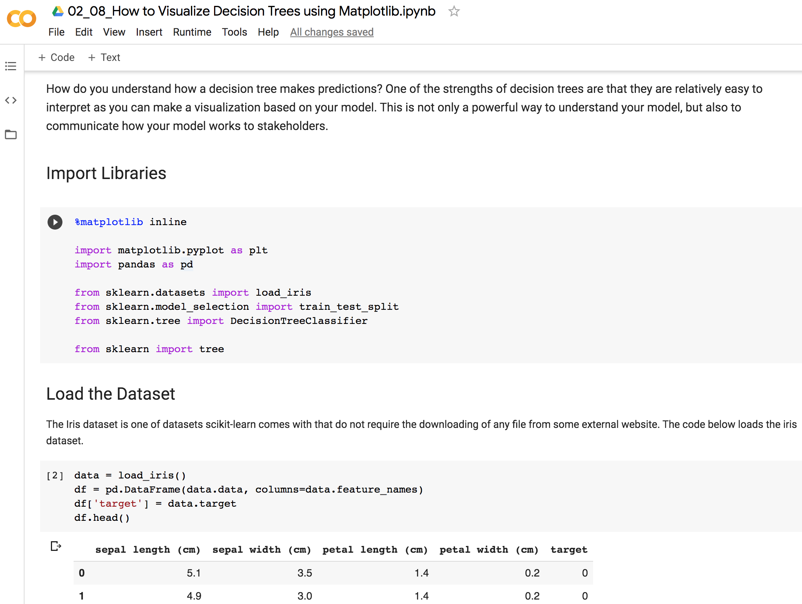

</div>
</div>

---

## Ciclo de entrenamiento y evaluación en PyTorch

1. **Definir** un `nn.Module`: capas, tamaños y activaciones.
2. **Preparar** un `Dataset` y sus lotes con `DataLoader`.
3. **Entrenar** con `model.train()`, `loss.backward()` y `optimizer.step()`.
4. **Validar/evaluar** con `model.eval()` y `torch.no_grad()`.

En clasificación con varias clases, la salida tiene una neurona por clase. `CrossEntropyLoss` recibe los *logits* directamente: no agregamos `softmax` dentro del modelo.

<div class="callout">
El ciclo es explícito, pero PyTorch tampoco decide por nosotros la arquitectura, la partición ni la métrica relevante.
</div>

---

## Ejemplo Pytorch

Ejemplo de clasificación binaria con datos artificiales: cuatro características, dos clases y una partición de 80 % para entrenamiento y 20 % para validación.

<div class="shared-code">

```python
import numpy as np
X = np.random.default_rng(7).normal(size=(1000, 4)).astype("float32")
y = (X[:, 0] + X[:, 1] > 0).astype("int64")
x_tr, x_val = X[:800], X[800:]
y_tr, y_val = y[:800], y[800:]
```

</div>

---

## Ejemplo Pytorch

<div class="columns code-compare">
<div>

**PyTorch: ciclo explícito**

```python
import torch
from torch import nn
from torch.utils.data import DataLoader, TensorDataset

train = DataLoader(TensorDataset(
    torch.from_numpy(x_tr), torch.from_numpy(y_tr)),
    batch_size=32, shuffle=True)
valid = DataLoader(TensorDataset(
    torch.from_numpy(x_val), torch.from_numpy(y_val)), batch_size=32)
model = nn.Sequential(
    nn.Linear(4, 16), nn.ReLU(), nn.Linear(16, 2))
loss_fn = nn.CrossEntropyLoss()
opt = torch.optim.Adam(model.parameters())
for _ in range(3):
    model.train()
    for xb, yb in train:
        opt.zero_grad()
        loss_fn(model(xb), yb).backward()
        opt.step()
model.eval()
with torch.no_grad():
    acc = sum((model(x).argmax(1) == y).sum().item()
              for x, y in valid) / len(y_val)
print("validación:", acc)
```

</div>
<div>

**TensorFlow/Keras: ciclo encapsulado**

```python
import tensorflow as tf

train = tf.data.Dataset.from_tensor_slices(
    (x_tr, y_tr)).shuffle(800).batch(32)
valid = tf.data.Dataset.from_tensor_slices(
    (x_val, y_val)).batch(32)
model = tf.keras.Sequential([
    tf.keras.layers.Input((4,)),
    tf.keras.layers.Dense(16, activation="relu"),
    tf.keras.layers.Dense(2)])
model.compile(optimizer="adam",
    loss=tf.keras.losses.SparseCategoricalCrossentropy(
        from_logits=True), metrics=["accuracy"])
model.fit(train, validation_data=valid, epochs=3, verbose=0)
print("validación:", model.evaluate(valid, verbose=0)[1])
```

</div>
</div>

Ambos ejemplos usan la misma red y pérdida. PyTorch muestra el cálculo de gradientes y la actualización; Keras los ejecuta dentro de `fit`.

---

## ¿El modelo funciona con datos nuevos?

La pérdida de entrenamiento mide el error en ejemplos usados para ajustar los pesos. Por sí sola, no indica cómo responderá el modelo ante ejemplos que no ha visto.

Medimos el error en un conjunto de **validación** separado del ajuste y comparamos:

$$
\text{brecha} = L_{\mathrm{val}} - L_{\mathrm{train}}
$$

- **Brecha pequeña y errores bajos:** el modelo también funciona bien en los ejemplos reservados.
- **Brecha grande:** puede haberse ajustado demasiado a los ejemplos de entrenamiento.

La validación guía la selección del modelo. La prueba se reserva para la evaluación final.

---

## Diagnóstico de subajuste y sobreajuste

<div class="columns">
<div>

**Subajuste**

- Error alto en entrenamiento.
- Modelo o características insuficientes.
- Optimización incompleta.

</div>
<div>

**Sobreajuste**

- Error bajo en entrenamiento.
- Brecha alta en validación.
- El modelo memoriza particularidades.

</div>
</div>

El objetivo es generalización: buen desempeño sobre datos no utilizados para ajustar decisiones. Las curvas de aprendizaje permiten observar cómo evolucionan el error de entrenamiento y el de validación al aumentar datos o épocas.

---

## Penalización de la función objetivo

Penalización $L_2$:

$$
L_{total}=L_{datos}+\lambda\sum_j w_j^2
$$

Penalización $L_1$:

$$
L_{total}=L_{datos}+\lambda\sum_j|w_j|
$$

El coeficiente $\lambda$ controla el compromiso entre ajustar los datos y restringir la complejidad efectiva del modelo.

---

## Estrategias de regularización y control de capacidad

Además de las penalizaciones, el protocolo puede incluir:

- **Dropout:** perturbar activaciones durante el entrenamiento.
- **Detención temprana:** elegir la época según validación.
- **Aumento de datos:** incorporar transformaciones que preservan la etiqueta.
- **Reducción de capacidad:** limitar capas, unidades o parámetros.

$L_1$ puede anular pesos, mientras que $L_2$ reduce su magnitud. Ajustamos $\lambda$ y las demás decisiones con validación.

---

## Dropout durante entrenamiento e inferencia

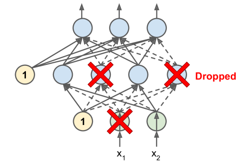

Para cada activación $a_j$, durante entrenamiento se muestrea una máscara:

$$
\widetilde a_j=\frac{m_j}{1-p}a_j,
\qquad m_j\sim\operatorname{Bernoulli}(1-p)
$$

Así, *dropout* anula activaciones con probabilidad $p$ y reduce la coadaptación. Durante inferencia no se eliminan unidades, la escala ya queda compensada.

---

## Detención temprana basada en validación

La detención temprana monitorea la pérdida de validación y conserva el instante de mejor desempeño:

$$
t^*=\arg\min_t L_{\mathrm{val}}(t)
$$

- Evita seguir ajustando cuando comienza el sobreajuste.
- Puede detener el entrenamiento antes del presupuesto máximo.
- Requiere decidir el criterio usando validación.

La prueba se evalúa una vez, después de fijar $t^*$ y todas las decisiones.

---

## Arquitecturas según la estructura de los datos

La arquitectura incorpora una **hipótesis inductiva**: una restricción que aprovecha la estructura esperada de la entrada.

| Estructura de la entrada | Hipótesis incorporada | Arquitectura inicial |
|---|---|---|
| Vector sin orden espacial o temporal | Interacciones globales entre características | Red densa o MLP |
| Secuencia ordenada | El pasado relevante afecta el presente | RNN, LSTM o GRU |
| Imagen o grilla | Patrones locales pueden aparecer en distintas posiciones | CNN |

La arquitectura, su capacidad y su costo computacional son hiperparámetros. Se comparan con el mismo protocolo de validación, no solo con la pérdida de entrenamiento.

---

## Redes recurrentes para dependencias temporales

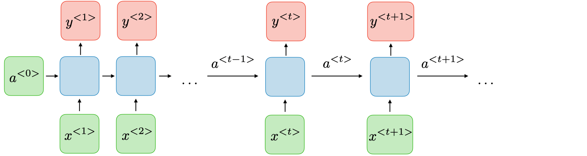

Una RNN comparte los mismos parámetros en cada instante y actualiza un estado oculto:

$$
\mathbf h_t=\phi(W_x\mathbf x_t+W_h\mathbf h_{t-1}+\mathbf b)
$$

El estado $\mathbf h_t$ resume la información previa que el modelo considera útil en el paso $t$. LSTM y GRU agregan compuertas para controlar qué información se conserva, se olvida o se expone en secuencias largas.

Las RNN simples pueden sufrir desvanecimiento o explosión del gradiente cuando deben transportar información a través de muchos pasos. Las compuertas atenúan este problema, aunque no eliminan la necesidad de validar el horizonte temporal y la arquitectura.

---

## Patrones de mapeo en datos secuenciales

| Patrón | Entrada y salida | Ejemplo |
|---|---|---|
| Uno a muchos | Un vector $\rightarrow$ una secuencia | Generación de una descripción |
| Muchos a uno | Una secuencia $\rightarrow$ una etiqueta | Clasificación de un texto |
| Muchos a muchos, alineado | Un valor por instante | Etiquetado de actividad por segundo |
| Muchos a muchos, no alineado | Una secuencia $\rightarrow$ otra secuencia | Traducción automática |

En series temporales, las particiones deben respetar causalidad. Mezclar aleatoriamente observaciones futuras puede filtrar información y producir una estimación de desempeño optimista.

---

## Pronóstico un paso adelante con una LSTM

El notebook usa la serie mensual de manchas solares para ilustrar una predicción un paso hacia adelante:

$$
(x_{t-w},\ldots,x_{t-1})\xrightarrow{\text{LSTM}}\mathbf h_t
\xrightarrow{\text{Dense}}\hat x_t
$$

- Separa entrenamiento y prueba por fecha, sin mezclar observaciones futuras.
- Ajusta el escalamiento exclusivamente sobre el período de entrenamiento.
- Construye ejemplos mediante ventanas temporales de ancho $w$.
- Compara la señal observada y la predicción en el período futuro.

La ventana $w$ define cuánto pasado recibe el modelo. El horizonte de predicción y el método de validación temporal deben corresponder a la decisión real que se quiere apoyar.

---

## Convoluciones: filtros locales y pesos compartidos

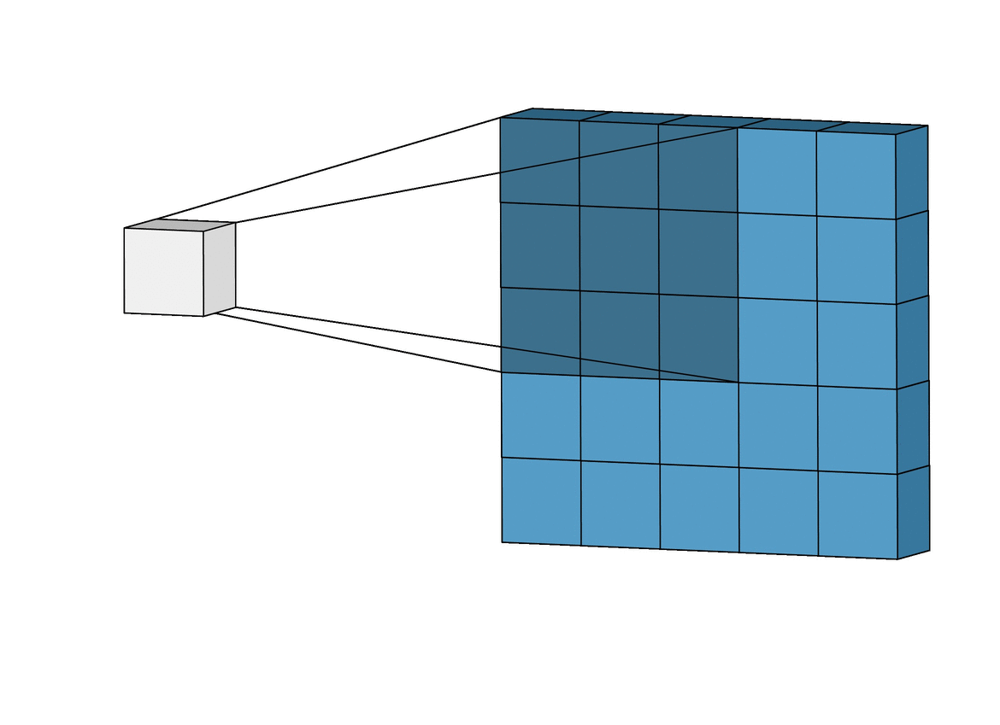

Para una convolución discreta 2D:

$$
Y_{i,j}=\sum_m\sum_n K_{m,n}X_{i+m,j+n}
$$

Un filtro $K$ recorre vecindarios locales de la entrada $X$. Sus pesos se comparten en todas las posiciones, por lo que pueden detectar el mismo patrón en distintos lugares con menos parámetros que una capa totalmente conectada.

Cada filtro produce un mapa de características. Capas sucesivas combinan bordes, texturas y patrones simples en representaciones de mayor nivel. El tamaño del filtro, el paso y el relleno son hiperparámetros que determinan la resolución de la salida.

---

## Pooling: reducción de resolución espacial

<div class="columns">
<div>

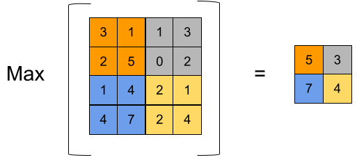

**Agrupación por máximo:** conserva la activación máxima de una región.

</div>
<div>

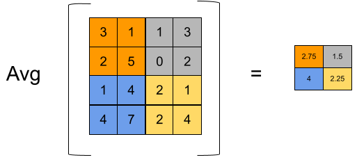

**Agrupación por promedio:** conserva el promedio de la región.

</div>
</div>

El *pooling* reduce la resolución espacial y el costo, pero también descarta información sobre la ubicación exacta de los patrones.

El tamaño de ventana y el paso determinan cuánto se reduce la representación. Una reducción agresiva puede eliminar detalles relevantes. No siempre conviene usarla en tareas que requieren localización precisa.

---

## Arquitectura CNN para clasificar CIFAR-10

El notebook usa imágenes de $32\times32$ píxeles, tres canales de color y diez clases. La arquitectura alterna extracción de características y reducción de resolución:

$$
\text{Conv2D}\rightarrow\text{MaxPooling}\rightarrow\text{Conv2D}
\rightarrow\text{MaxPooling}\rightarrow\text{Conv2D}
\rightarrow\text{Dense}\rightarrow\text{softmax}
$$

Las convoluciones extraen patrones locales. Las capas densas combinan la representación final para clasificar. La profundidad, los canales y la regularización deben seleccionarse con validación.

<div class="warn">
El ejemplo entrena durante un número fijo de épocas y evalúa en prueba. Para comparar arquitecturas, conviene añadir validación y mantener el mismo protocolo.
</div>

---

## Diseño experimental antes de entrenar una red

1. **Definir** la tarea, población objetivo, decisión y métrica de éxito.
2. **Construir** una línea base simple que establezca un desempeño de referencia.
3. **Separar** datos antes de ajustar transformaciones, respetando tiempo, grupos y clases cuando corresponda.
4. **Fijar** presupuesto de cómputo, semillas, arquitectura inicial y espacio de hiperparámetros.

<div class="callout">
Una red más profunda solo es mejor si supera una línea base bajo una comparación justa y con un costo aceptable.
</div>

---

## Selección, prueba y reporte del experimento

1. **Entrenar** cada configuración solo con entrenamiento y monitorear validación.
2. **Seleccionar** hiperparámetros y época con una regla definida antes de mirar prueba.
3. **Reentrenar**, si el protocolo lo contempla, usando únicamente los datos autorizados.
4. **Evaluar** el conjunto de prueba una vez y reportar la métrica acordada.
5. **Analizar** errores por clase, segmento, condición y costo operacional.

Al comparar modelos, informe también variabilidad entre semillas, tiempo de entrenamiento, recursos usados y limitaciones de los datos. Un único valor de exactitud no caracteriza completamente un experimento.

---

## Notebook de referencia: Fashion MNIST con PyTorch

El notebook principal [`notebook/04_clasificacion_fashion_mnist_pytorch.ipynb`](notebook/04_clasificacion_fashion_mnist_pytorch.ipynb):

- usa Fashion MNIST: imágenes en escala de grises de prendas, agrupadas en diez categorías.
- normaliza imágenes y separa entrenamiento, validación y prueba.
- entrena una red densa con `DataLoader`, *dropout* y un ciclo explícito.
- usa detención temprana sobre la pérdida de validación.
- calcula matriz de confusión, exactitud global y exactitud por clase.

El ejemplo sigue la API de PyTorch y deja explícitas las semillas, la partición y el dispositivo utilizado. El notebook equivalente en TensorFlow queda como material de comparación en el anexo.

---

## Principios para diseñar y evaluar redes neuronales

- El punto de partida es la tarea, los datos y la métrica. La arquitectura es una hipótesis que debe validarse.
- El entrenamiento minimiza una pérdida promedio: retropropagación calcula gradientes y el optimizador actualiza parámetros.
- La separación entre entrenamiento, validación y prueba protege la estimación de generalización.
- Regularización, capacidad y detención temprana se eligen como parte del protocolo experimental.
- RNN explotan dependencia temporal. CNN explotan localidad y compartición de pesos.

<div class="bridge">
Estos principios se retomarán al estudiar arquitecturas especializadas y sus aplicaciones en aprendizaje profundo.
</div>

---

## Anexo: TensorFlow y Keras

TensorFlow es un framework para trabajar con tensores, diferenciación automática y modelos de aprendizaje profundo.

Su API de alto nivel más conocida es **Keras**, que permite describir modelos secuenciales y delegar el ciclo de entrenamiento en métodos como `fit`.

En este curso lo dejamos como referencia. La implementación principal y los ejemplos de la clase usan PyTorch.

<div class="bridge">
La idea matemática no cambia: datos → modelo → pérdida → gradientes → actualización → evaluación.
</div>

---

## Anexo: equivalencias entre PyTorch y TensorFlow/Keras

| Concepto | PyTorch | TensorFlow / Keras |
|---|---|---|
| Tensor | `torch.Tensor` | `tf.Tensor` |
| Capa densa | `nn.Linear` | `keras.layers.Dense` |
| Modelo | `nn.Module` | `keras.Model` / `Sequential` |
| Pérdida para varias clases | `nn.CrossEntropyLoss` | `SparseCategoricalCrossentropy(from_logits=True)` |
| Optimizador | `torch.optim.Adam` | `keras.optimizers.Adam` |
| Lotes de datos | `DataLoader` | `tf.data.Dataset` |
| Entrenar/evaluar | `model.train()` / `model.eval()` | `training=True` / `training=False` |

Las diferencias principales están en la interfaz y el nivel de automatización, no en el objetivo del aprendizaje.

---

## Anexo: ciclos de entrenamiento explícito y encapsulado

<div class="columns">
<div>

**PyTorch: ciclo explícito**

```python
model.train()
for x, y in loader:
    optimizer.zero_grad()
    loss = criterion(model(x), y)
    loss.backward()
    optimizer.step()
```

</div>
<div>

**TensorFlow/Keras: ciclo encapsulado**

```python
model.compile(
    optimizer="adam",
    loss=SparseCategoricalCrossentropy(from_logits=True)
)
model.fit(x_train, y_train,
          validation_data=(x_val, y_val))
```

</div>
</div>

Ambos siguen el mismo flujo: paso hacia adelante, pérdida, gradientes y actualización. En PyTorch cada paso queda visible. `fit` empaqueta ese flujo y agrega opciones de entrenamiento.

---

## Anexo: notebooks equivalentes para el mismo experimento

Los dos notebooks desarrollan el mismo experimento para comparar implementaciones:

- [`04_clasificacion_fashion_mnist_pytorch.ipynb`](notebook/04_clasificacion_fashion_mnist_pytorch.ipynb): versión principal de la clase.
- [`04_clasificacion_fashion_mnist_tensorflow.ipynb`](notebook/04_clasificacion_fashion_mnist_tensorflow.ipynb): versión de referencia para este anexo.

Ambos normalizan Fashion MNIST, mantienen la misma partición entrenamiento/validación/prueba y usan una red densa con 128 unidades ReLU, dropout de 0.25 y 10 *logits*. También aplican detención temprana, reporte por clase y matriz de confusión normalizada.

Los valores exactos pueden variar entre entornos de trabajo y hardware. La comparación justa debe conservar los datos, la arquitectura, las particiones y la métrica.

---

## Referencias y material de profundización

- Material original de IPD434 (referencia histórica, con ejemplos TensorFlow): `04_RedesNeuronales.ipynb`.
- Notebook principal reproducible: `notebook/04_clasificacion_fashion_mnist_pytorch.ipynb`.
- Notebook de referencia para el anexo: `notebook/04_clasificacion_fashion_mnist_tensorflow.ipynb`.
- A. Géron, *Hands On Machine Learning with Scikit Learn, Keras & TensorFlow*, O'Reilly.
- Stanford, *CS229 Machine Learning Notes*.
- I. Goodfellow, Y. Bengio y A. Courville, *Deep Learning*, MIT Press, 2016.
- C. M. Bishop, *Pattern Recognition and Machine Learning*, Springer, 2006.
- F. Chollet, *Deep Learning with Python*, 2.ª ed., Manning, 2021.
- PyTorch, documentación oficial de módulos, optimización y carga de datos.
- TensorFlow/Keras, documentación oficial de clasificación y modelos secuenciales.
