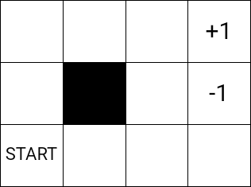
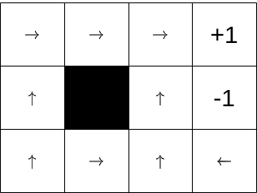
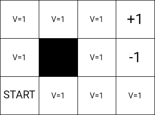
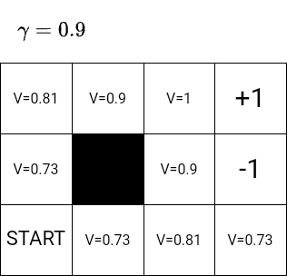
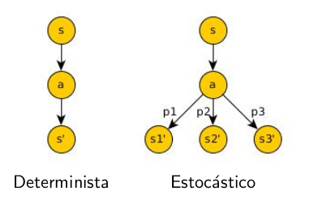
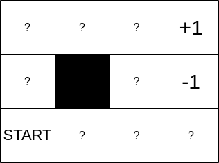
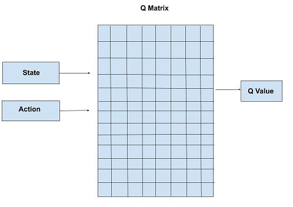
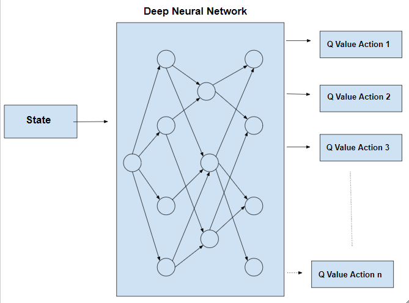

<!-- _class: lead -->

# IPD434
## Aprendizaje por refuerzo
### Deep Reinforcement Learning

Dr. Patricio Olivares Roncagliolo

---

## ¿Qué problema resuelve el aprendizaje por refuerzo?

- Un agente aprende a decidir mientras interactúa con un entorno
- En cada paso observa una situación y elige una acción
- El entorno cambia y devuelve una recompensa
- El agente busca una política que aumente la recompensa total
- El entorno no indica la acción correcta para cada estado
- El agente aprende a partir de las recompensas que recibe con el tiempo

**Ejemplos de decisiones secuenciales** elegir una jugada en ajedrez o controlar un robot caminante

El [video de DeepMind](https://www.youtube.com/watch?v=V1eYniJ0Rnk) muestra un agente que aprende a jugar

---

## El ciclo de interacción

- El agente recibe el estado actual $s_t$
- La política elige la acción $a_t$
- El entorno devuelve la recompensa $r_{t+1}$ y el estado siguiente $s_{t+1}$
- Ese nuevo estado inicia el paso siguiente

$$s_t\xrightarrow{a_t}(r_{t+1},s_{t+1})$$

La política aprende al repetir este ciclo con distintas experiencias

---

## Elementos del problema

- **Agente** quien elige acciones y aprende de sus resultados
- **Entorno** el mundo real o simulado que responde a cada acción
- **Estado** $s_t$ información disponible para decidir en el paso $t$
- **Acción** $a_t$ alternativa que el agente puede ejecutar desde $s_t$

Un estado útil contiene la información necesaria para elegir la siguiente acción

---

## Recompensa y política

- **Recompensa** $r_{t+1}$ señal inmediata del resultado de una acción
- Puede ser positiva o negativa según el objetivo
- **Política** $\pi(a\mid s)$ regla que indica qué acción elegir desde cada estado
- Una buena política busca un retorno favorable a lo largo del tiempo y no solo una ganancia inmediata

Para describir las decisiones y sus resultados usamos un proceso de decisión de Markov

---

## El proceso de decisión de Markov

Un MDP organiza los estados las acciones las transiciones y las recompensas del problema

$$\mathcal{M}=(S,A,P,R,\gamma)$$

- $S$ reúne los estados posibles y $A$ las acciones disponibles
- $P(s'\mid s,a)$ indica la probabilidad de llegar a $s'$ desde $s$ al elegir $a$
- $R(s,a,s')$ es la recompensa al realizar esa transición
- $\gamma\in[0,1)$ es el factor que reduce el peso de las recompensas futuras

Con estos elementos podemos describir cada paso del agente

---

## De una decisión a la siguiente

- En el paso $t$ el agente está en $s_t$ y elige $a_t$
- La función $P(s_{t+1}\mid s_t,a_t)$ describe qué estados pueden aparecer después
- El entorno devuelve $s_{t+1}$ y la recompensa $R(s_t,a_t,s_{t+1})$
- El proceso continúa desde el estado nuevo

La propiedad de Markov indica que el estado actual resume la información necesaria para predecir el próximo estado

---

## Retorno: sumar recompensas futuras

$$G_t=R_{t+1}+\gamma R_{t+2}+\gamma^2R_{t+3}+\cdots$$

- $R_{t+1}$ es la recompensa recibida después de elegir $a_t$
- $G_t$ suma las recompensas futuras y las descuenta con $\gamma$
- Si $\gamma$ se acerca a uno cuentan más los resultados lejanos
- Si $\gamma$ se acerca a cero cuentan más las recompensas inmediatas
- El agente busca maximizar el retorno esperado

Este retorno permite comparar las consecuencias de distintas políticas

---

## Valor de una política

El valor $V^\pi(s)$ es el retorno descontado esperado al partir del estado $s$ y seguir la política $\pi$

$$V^\pi(s)=\mathbb{E}\left[\sum_{t=0}^{\infty}\gamma^tR_{t+1}\mid s_0=s,\pi\right]$$

- $\mathbb{E}$ representa el promedio sobre las posibles trayectorias
- Un valor alto indica que seguir $\pi$ desde $s$ suele producir más recompensa futura

La ecuación de Bellman expresa este valor usando el paso inmediato y los estados siguientes

---

## Ecuación de Bellman

El valor de un estado combina la recompensa del paso actual con el valor esperado del futuro

$$V^\pi(s)=\sum_a\pi(a\mid s)\sum_{s'}P(s'\mid s,a)\left[R(s,a,s')+\gamma V^\pi(s')\right]$$

- $\pi(a\mid s)$ es la probabilidad de elegir la acción $a$ en el estado $s$
- $P(s'\mid s,a)$ pondera cada estado siguiente posible
- El término entre corchetes suma recompensa inmediata y valor futuro descontado

En el mundo grilla cada casilla será un estado y cada movimiento una acción

---

## Caso de estudio: mundo grilla

- Cada casilla representa un estado y el espacio negro es inaccesible
- El agente puede moverse arriba abajo izquierda o derecha
- La casilla terminal positiva entrega $+1$ y la negativa entrega $-1$
- El objetivo es llegar a la recompensa positiva sin terminar en la negativa

---

## Una política asigna acciones a los estados

- Cada flecha muestra la acción que el agente elige desde esa casilla
- La política transforma el estado actual en una decisión local
- Al aplicar la misma regla en cada paso se obtiene una ruta por la grilla

---

## Mundo grilla determinista

- Cada acción produce el movimiento esperado con probabilidad uno
- Una ruta óptima desde el inicio es $\uparrow,\uparrow,\rightarrow,\rightarrow,\rightarrow$
- La evaluación considera la recompensa acumulada al completar la ruta

---

## El descuento puede cambiar la ruta

- El factor $\gamma$ reduce el valor de las recompensas que tardan más en llegar
- Una ruta corta hacia $+1$ puede ser mejor que otra más larga
- Los valores mostrados en la grilla reflejan la recompensa y la distancia hasta ella

---

## ¿Qué ocurre si las acciones son inciertas?

- Al elegir arriba el agente avanza en esa dirección con probabilidad 80 %
- Con probabilidad 10 % se mueve a cada lado
- Las probabilidades de los resultados posibles suman 100 %
- El valor de una acción combina cada recompensa con la probabilidad de su resultado

---

## Value Iteration: actualizar los valores

- Inicializar $V_0(s)=0$ para todos los estados
- Actualizar cada valor usando las transiciones posibles

$$V_{k+1}(s)=\max_a\sum_{s'}P(s'\mid s,a)\left[R(s,a,s')+\gamma V_k(s')\right]$$

- El máximo conserva la acción con el mayor retorno esperado
- Repetir hasta que los valores se estabilicen

$V_k(s)$ es la estimación del valor en la iteración $k$

---

## De los valores a una política

La convergencia produce el valor óptimo $V^*(s)$ para cada estado

La política óptima escoge la acción con mayor retorno esperado:

$$\pi^*(s)=\arg\max_a\sum_{s'}P(s'\mid s,a)\left[R(s,a,s')+\gamma V^*(s')\right]$$

La expresión compara la recompensa inmediata y el valor futuro de cada acción

---

## Q learning: aprender desde la experiencia

- No es necesario conocer por adelantado $P$ ni $R$
- $Q(s,a)$ estima el retorno al elegir la acción $a$ desde el estado $s$
- Después de observar la recompensa $r$ y el estado siguiente $s'$ se actualiza:

$$Q(s,a)\leftarrow Q(s,a)+\alpha\left[r+\gamma\max_{a'}Q(s',a')-Q(s,a)\right]$$

- $\alpha$ controla cuánto cambia la estimación en cada observación
- $\gamma$ descuenta el valor futuro
- El máximo selecciona la acción con mayor valor en el estado siguiente

---

## ¿Cómo se interpretan los valores $Q$?

- $Q(s,a)$ permite comparar las acciones disponibles dentro de un estado
- El valor $V(s)$ corresponde a la mejor de esas estimaciones:

$$V(s)=\max_a Q(s,a)$$

- La política codiciosa elige $\pi(s)=\arg\max_a Q(s,a)$

Una tabla resulta práctica en espacios pequeños pero crece con el número de estados y acciones

---

## De una tabla $Q$ a una red neuronal

<h3>Q learning en tabla</h3>

Guarda un valor para cada par de estado y acción

<h3>Deep Q Learning</h3>

Recibe el estado y estima el valor de cada acción posible

---

## Deep Q Network (DQN)

- La red de política usa parámetros $\theta$ para estimar $Q_\theta(s,a)$ desde un estado
- La red objetivo usa parámetros $\theta^-$ para estimar el valor futuro
- Ambas redes estiman valores para las acciones disponibles

La red objetivo ayuda a mantener estable el aprendizaje

---

## Objetivo de aprendizaje de DQN

La red aprende un objetivo que combina la recompensa observada con el mejor valor futuro

$$y_t=r_{t+1}+\gamma(1-d_t)\max_{a'}Q_{\theta^-}(s_{t+1},a')$$

- $r_{t+1}$ es la recompensa recibida después de la acción
- $d_t=1$ cuando el estado siguiente es terminal y evita sumar un valor futuro
- La red de política ajusta $Q_\theta(s_t,a_t)$ para acercarlo a $y_t$

---

## Entrenamiento de un DQN

- Con probabilidad $\epsilon$ explorar una acción al azar y en los demás pasos elegir la de mayor $Q$
- Guardar cada experiencia de estado acción recompensa y estado siguiente en la memoria
- Aprender desde lotes aleatorios de esa memoria
- Ajustar la red de política para reducir el error respecto al objetivo
- Copiar periódicamente los parámetros a la red objetivo y disminuir $\epsilon$

---

## Gymnasium: probar agentes en entornos

- Proporciona una API común para observar estados ejecutar acciones y recibir recompensas
- `reset()` inicia un episodio y devuelve el estado inicial
- `step(action)` devuelve el estado siguiente la recompensa y las señales `terminated` y `truncated`
- `terminated` indica que se alcanzó un estado terminal y `truncated` que terminó el tiempo disponible
- Incluye entornos clásicos como CartPole

Documentación de [Gymnasium](https://gymnasium.farama.org/)

---

## Ejemplo práctico: DQN en CartPole

- El estado contiene la posición y velocidad del carro junto con el ángulo y la velocidad del péndulo
- Las dos acciones empujan el carro a la izquierda o a la derecha
- El agente recibe recompensa mientras mantiene el péndulo equilibrado
- El notebook entrena el DQN y evalúa la política en episodios nuevos

[Abrir notebook PyTorch de DQN para CartPole](notebook/05_1_dqn_cartpole_pytorch.ipynb)

---

## Ideas clave

- El aprendizaje por refuerzo optimiza decisiones secuenciales mediante el retorno esperado
- Un MDP describe estados acciones transiciones y recompensas
- Value Iteration usa un modelo conocido y Q learning aprende desde muestras
- Deep Q Network aproxima los valores cuando una tabla no resulta práctica

---

## Lecturas y referencias

- A Géron · libro sobre aprendizaje automático con Scikit Learn Keras y TensorFlow
- Stanford · [CS229 Notes](https://cs229.stanford.edu/)
- [Documentación de Gymnasium](https://gymnasium.farama.org/)
- Diagrama de Deep Q Network · [GeeksforGeeks](https://www.geeksforgeeks.org/deep-q-learning/)
