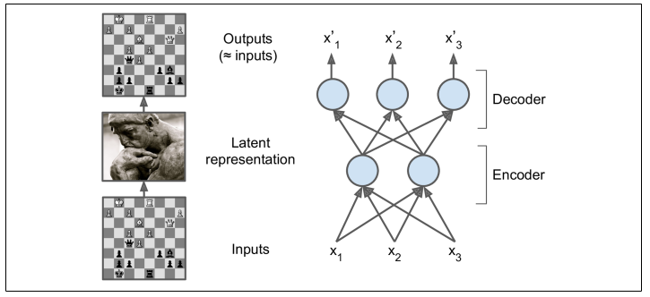
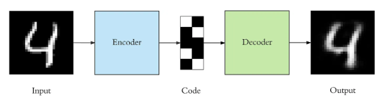
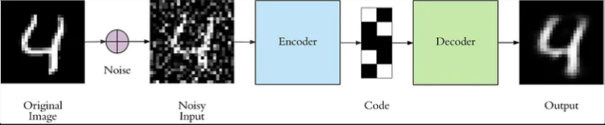
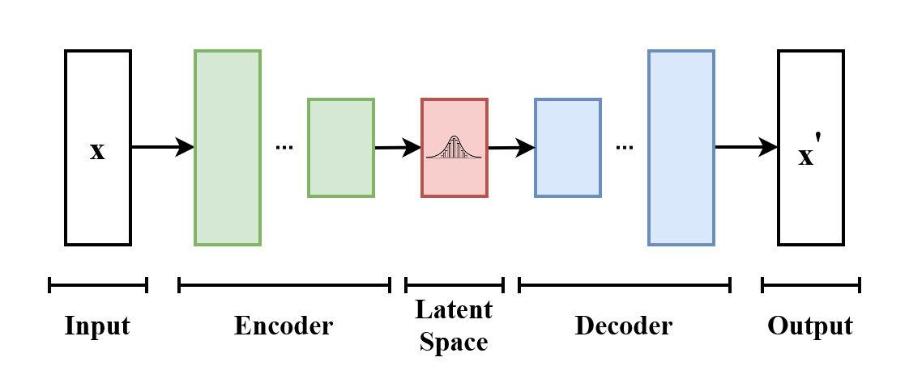
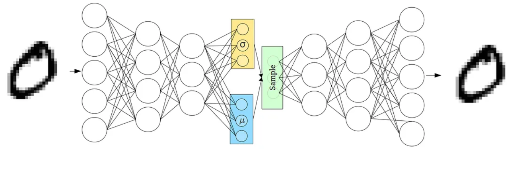
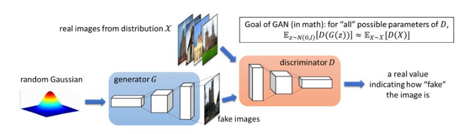

<!-- _class: lead -->

# IPD434
## Redes generativas
### Autoencoders, VAE y GAN

Dr. Patricio Olivares Roncagliolo

Ingeniería Civil Telemática · Universidad Técnica Federico Santa María

---

## Autoencoder: comprimir y reconstruir

- Un **encoder** transforma la entrada $x$ en una representación latente $z$.
- Un **decoder** reconstruye la entrada como $\hat{x}$.
- El entrenamiento busca que la reconstrucción se parezca a la entrada.

$$x\longrightarrow z\longrightarrow\hat{x}$$

---

## Una representación latente compacta

- El encoder reduce la dimensión y conserva rasgos útiles.
- El decoder aprende a recuperar la estructura original desde $z$.
- Una reconstrucción más cercana indica que la representación retiene información relevante.

---

## ¿Dónde se usan los autoencoders?

- **Reducción de dimensionalidad:** representar datos con menos variables.
- **Eliminación de ruido:** reconstruir la señal relevante de una entrada perturbada.
- **Detección de anomalías:** buscar ejemplos que el modelo reconstruye mal.

---

## Autoencoder convolucional

- Las convoluciones preservan la estructura espacial de las imágenes.
- El encoder reduce resolución y extrae patrones locales.
- El decoder reconstruye la imagen desde las características comprimidas.

[Notebook PyTorch: autoencoders convolucionales y VAE](notebook/05_3_autoencoders_vae_pytorch.ipynb)

---

## VAE: una distribución en el espacio latente

- Un **Variational Autoencoder** aprende una distribución latente, no solo un código fijo.
- El encoder estima parámetros como la media $\mu$ y la varianza $\sigma^2$.
- Muestrear desde esa distribución permite generar ejemplos nuevos.

---

## Muestrear y generar con un VAE

La reparametrización expresa la muestra latente de forma diferenciable:

$$z=\mu+\sigma\odot\epsilon,\qquad \epsilon\sim\mathcal{N}(0,I)$$

- El decoder convierte cada muestra $z$ en una observación.
- Cambiar la muestra permite producir salidas distintas.

---

## Práctica: autoencoders y VAE en PyTorch

El notebook compara reconstrucciones de modelos densos y convolucionales, entrena un VAE y muestra muestras latentes.

[Abrir notebook PyTorch de autoencoders y VAE](notebook/05_3_autoencoders_vae_pytorch.ipynb)

---

## GAN: dos redes con objetivos opuestos

- El **generador** transforma ruido $z$ en datos sintéticos $G(z)$.
- El **discriminador** estima si una entrada proviene de datos reales o fue generada.
- Ambos se entrenan en competencia.

---

## El entrenamiento alterna dos fases

<h3>1. Discriminador</h3>
<ul>
<li>Ve ejemplos reales y generados.</li>
<li>Aprende a distinguir ambas clases.</li>
</ul>

<h3>2. Generador</h3>
<ul>
<li>Recibe ruido aleatorio.</li>
<li>Aprende a engañar al discriminador.</li>
</ul>

---

## Fase 1: el discriminador distingue

- Se mezclan muestras reales $x$ con muestras falsas $G(z)$.
- Las etiquetas objetivo son 1 para reales y 0 para generadas.
- Su objetivo es maximizar:

$$\log D(x)+\log\left(1-D(G(z))\right)$$

---

## Fase 2: el generador engaña

- Se genera un nuevo lote a partir de ruido.
- El discriminador recibe las imágenes generadas, pero se busca que responda “real”.
- El generador aumenta la probabilidad $D(G(z))$:

$$\max_G\;\log D(G(z))$$

---

## Una dinámica adversarial inestable

- Generador y discriminador se actualizan alternadamente.
- El objetivo ideal es que el discriminador no distinga mejor que al azar (50 %).
- Si uno de los modelos se vuelve demasiado fuerte, el otro puede dejar de aprender.

---

## De ruido a imagen: el generador antes de aprender

- Una red puede transformar un vector latente en una imagen de tamaño $28\times28$.
- Antes del entrenamiento, sus pesos aleatorios producen patrones sin significado.
- El ejemplo prepara la intuición para el entrenamiento adversarial.

[Ver el generador y el entrenamiento GAN en el notebook PyTorch de MNIST](notebook/05_3_gan_mnist_pytorch.ipynb)

---

## Ejemplo completo: GAN para MNIST

- El generador convierte ruido en imágenes de dígitos.
- El discriminador clasifica imágenes reales y generadas.
- Al terminar cada época se revisan muestras nuevas y las pérdidas de ambos modelos.

[Abrir notebook PyTorch de GAN con MNIST](notebook/05_3_gan_mnist_pytorch.ipynb)

---

## Autoencoder, VAE y GAN: tres objetivos distintos

| Modelo | Qué aprende | Para qué sirve |
|---|---|---|
| AE | Una representación que reconstruye la entrada | Compresión y reconstrucción |
| VAE | Una distribución latente muestreable | Generar variaciones plausibles |
| GAN | Un generador que engaña a un discriminador | Crear datos sintéticos realistas |

---

## Ideas clave

- AE y VAE aprenden a reconstruir; el VAE además organiza el espacio latente para muestrear.
- Una GAN aprende mediante la competencia entre generador y discriminador.
- El equilibrio y la calidad de las muestras dependen del entrenamiento, no solo de la arquitectura.

---

## Lecturas y fuentes de figuras

- A. Géron, *Hands-on Machine Learning with Scikit-Learn, Keras & TensorFlow*.
- Diagrama de AE: [Applied Deep Learning](https://towardsdatascience.com/applied-deep-learning-part-3-autoencoders-1c083af4d798).
- VAE: [Wikipedia](https://en.wikipedia.org/wiki/Variational_autoencoder) y [Towards Data Science](https://towardsdatascience.com/intuitively-understanding-variational-autoencoders-1bfe67eb5daf).
- GAN: [Microsoft Research](https://www.microsoft.com/en-us/research/blog/how-can-generative-adversarial-networks-learn-real-life-distributions-easily/).
