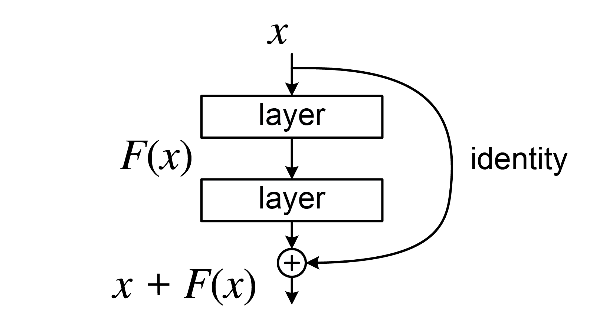
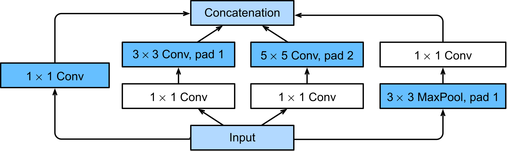

<!-- _class: lead -->

# IPD434
## CNN profundas y arquitecturas modernas
### ResNet, Inception y EfficientNet

Dr. Patricio Olivares Roncagliolo

Ingeniería Civil Telemática · Universidad Técnica Federico Santa María

---

## ¿Por qué aumentar la profundidad?

- Las CNN aprovechan patrones espaciales locales en imágenes.
- Más capas pueden construir representaciones cada vez más abstractas.
- Redes más profundas aumentan la capacidad, pero también el costo y la dificultad de entrenamiento.

---

## Más capas no garantizan mejor rendimiento

- Una CNN muy profunda puede rendir peor que una red pequeña incluso en entrenamiento.
- Este **problema de degradación** no equivale al sobreajuste.
- La comparación debe usar los mismos datos y el mismo protocolo de evaluación.

---

## Gradientes que desaparecen o explotan

- En retropropagación, los gradientes transmiten a cada capa cómo ajustar sus pesos.
- Si se vuelven muy pequeños, las primeras capas casi no aprenden (**vanishing gradients**).
- Si se vuelven demasiado grandes, las actualizaciones son inestables (**exploding gradients**).
- La profundidad amplifica estos problemas y motiva nuevas conexiones.

---

## Conexiones residuales: aprender una corrección

En vez de aprender directamente una transformación completa, el bloque aprende una corrección $F(x)$:

$$y=F(x)+x$$

- La entrada $x$ dispone de un atajo hasta la salida.
- Si conviene conservar la representación, la red puede aproximar la identidad.

---

## Anatomía de un bloque residual

- **Conv2D + BatchNorm:** transforma la entrada.
- **Add:** suma la entrada original mediante *skip connection*.
- **ReLU:** aplica la no linealidad después de la suma.

---

## ¿Qué aporta ResNet?

- Mantiene rutas directas para el flujo de gradientes.
- Facilita entrenar redes profundas y aprender funciones identidad.
- Las conexiones residuales permiten concentrar el aprendizaje en los cambios necesarios.

---

## Experimento: comparar profundidad en CIFAR-10

- La práctica compara una CNN sencilla, una profunda y una más sobrecargada.
- Se usa validación para elegir el mejor estado de cada modelo.
- El notebook también implementa una ResNet pequeña con bloques residuales.

[Abrir notebook PyTorch de profundidad y ResNet](notebook/05_4_cnn_depth_resnet_pytorch.ipynb)

---

## ResNet50: una arquitectura profunda en práctica

- La capa final se adapta a las diez clases de CIFAR-10.
- El notebook ejecuta un paso de entrenamiento desde cero para comprobar salida, pérdida y gradientes.
- El ejemplo permite observar el costo de una arquitectura grande antes de un entrenamiento completo.

[Ver la prueba de ResNet50 en el notebook PyTorch](notebook/05_4_cnn_depth_resnet_pytorch.ipynb)

---

## Inception: filtros paralelos y varias escalas

- Un bloque procesa la misma entrada por varias ramas en paralelo.
- Cada rama usa filtros o *pooling* distintos.
- Al concatenar sus salidas, el bloque reúne características de diferentes escalas.

---

## Estructura de un bloque Inception

- La entrada se distribuye entre ramas y sus salidas se concatenan.
- Las convoluciones $1\times1$, $3\times3$ y $5\times5$ capturan patrones distintos.

---

## Cuatro ramas de Inception v1

- **Rama 1:** convolución $1\times1$.
- **Rama 2:** reducción $1\times1$ seguida de $3\times3$.
- **Rama 3:** reducción $1\times1$ seguida de $5\times5$.
- **Rama 4:** *max pooling* y proyección $1\times1$.

Las salidas se concatenan para combinar información de múltiples escalas.

---

## InceptionV3: demostración en PyTorch

- El notebook compara la forma de salida, la pérdida y el flujo de gradientes.
- La prueba usa un subconjunto pequeño de CIFAR-10 para ilustrar el ciclo de entrenamiento.

[Abrir notebook PyTorch de InceptionV3 y EfficientNetB0](notebook/05_4_inception_efficientnet_pytorch.ipynb)

---

## EfficientNet: escalar de forma equilibrada

- EfficientNet escala **profundidad**, **anchura** y **resolución** de forma conjunta.
- El *compound scaling* busca aumentar capacidad sin elevar innecesariamente el costo.
- Su bloque básico, MBConv, combina convoluciones eficientes y recalibración de canales.

---

## MBConv: expandir, filtrar y proyectar

1. **Expandir:** una convolución $1\times1$ aumenta los canales.
2. **Procesar:** la convolución *depthwise* aplica filtros por canal.
3. **Recalibrar:** el bloque *Squeeze-and-Excitation* pondera canales relevantes.
4. **Proyectar:** otra convolución $1\times1$ reduce los canales.

El atajo residual se usa cuando las dimensiones de entrada y salida coinciden.

---

## ¿De dónde viene la eficiencia de MBConv?

- Las convoluciones *depthwise* requieren menos parámetros que una convolución estándar.
- La expansión y la proyección controlan cómo se combinan los canales.
- El bloque conserva información útil con menor costo computacional.

---

## EfficientNetB0: demostración en PyTorch

- La práctica entrena y evalúa un ciclo corto con un subconjunto de CIFAR-10.
- Se compara la arquitectura con InceptionV3 bajo el mismo flujo de datos.

[Abrir notebook PyTorch de InceptionV3 y EfficientNetB0](notebook/05_4_inception_efficientnet_pytorch.ipynb)

---

## Regularización: mejorar la generalización

- **Batch Normalization:** estabiliza activaciones durante el entrenamiento.
- **Data Augmentation:** aumenta la variedad de ejemplos observados.
- **Label Smoothing:** evita que las etiquetas transmitan certeza absoluta.

Las técnicas se comparan con un mismo protocolo de validación.

---

## Batch Normalization

- Normaliza las activaciones de cada mini-lote.
- Aprende parámetros $\gamma$ y $\beta$ para conservar flexibilidad.
- Suele colocarse después de una convolución o capa densa y antes de la activación.
- Puede estabilizar y acelerar el entrenamiento; no sustituye la validación.

---

## Data Augmentation: variar los datos de entrenamiento

- Aplica transformaciones que mantienen la etiqueta del ejemplo.
- En imágenes se usan rotaciones, desplazamientos, *flips* y cambios de escala.
- Aumenta la diversidad observada y ayuda a reducir el sobreajuste.

---

## Cutout: aprender con partes ocultas

- Oculta un parche aleatorio dentro de cada imagen.
- Obliga a usar contexto distribuido, no solo una región pequeña.
- Simula oclusiones y puede mejorar la robustez.

---

## Mixup: interpolar ejemplos y etiquetas

- Combina dos imágenes mediante una interpolación ponderada.
- Aplica la misma combinación a sus etiquetas.
- Suaviza fronteras de decisión y reduce la confianza excesiva.

---

## Label Smoothing: suavizar las etiquetas

- Sustituye la etiqueta dura por una distribución con menos certeza.
- Para $N$ clases, la clase correcta recibe $1-\varepsilon$ y las demás comparten $\varepsilon$.
- Con cuatro clases y $\varepsilon=0.1$: $[0.033,\;0.9,\;0.033,\;0.033]$.

---

## Comparar regularizadores de forma justa

- El notebook compara línea base, BatchNorm, Cutout, Mixup y Label Smoothing.
- Mantiene la misma partición y arquitectura para atribuir las diferencias a cada estrategia.
- La selección se hace con validación; la prueba se reserva para la evaluación final.

[Abrir notebook PyTorch de regularización de CNN](notebook/05_4_cnn_regularizacion_pytorch.ipynb)

---

## Ideas clave

- **ResNet** facilita optimizar redes profundas mediante conexiones residuales.
- **Inception** combina filtros paralelos para capturar distintas escalas.
- **EfficientNet** coordina la escala y usa bloques MBConv eficientes.
- La regularización se elige y evalúa según su efecto en datos no vistos.

---

## Lecturas y material práctico

- A. Géron, *Hands-on Machine Learning with Scikit-Learn, Keras & TensorFlow*.
- [Notebook: profundidad y ResNet](notebook/05_4_cnn_depth_resnet_pytorch.ipynb).
- [Notebook: InceptionV3 y EfficientNetB0](notebook/05_4_inception_efficientnet_pytorch.ipynb).
- [Notebook: técnicas de regularización](notebook/05_4_cnn_regularizacion_pytorch.ipynb).
