<!-- _class: lead -->

# Soft Computing
## Repaso de complejidad, sistemas difusos, computación evolutiva y redes neuronales

---

<!-- _class: lead -->

# Complejidad y búsqueda aproximada
## Cuándo una solución exacta es inviable

---

## Soft Computing: soluciones aproximadas

**Soft Computing** reúne técnicas que entregan soluciones aproximadas, pero útiles, cuando la solución exacta es muy costosa o no se puede calcular.

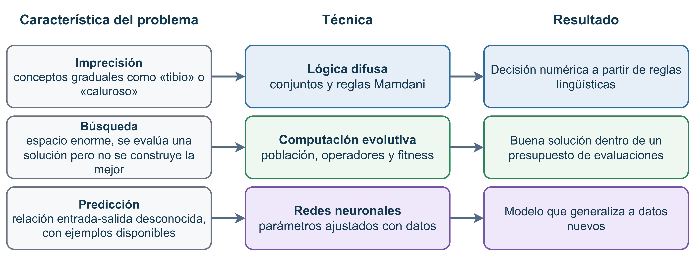

---

## Cómo se describe una solución

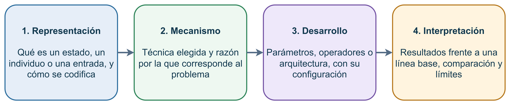

Cada técnica se explica con las mismas cuatro partes. La interpretación compara el resultado con una referencia y declara sus límites.

---

<!-- _class: compact -->

## Espacio de búsqueda y su crecimiento

Un **estado** es una configuración posible del problema. El **espacio de búsqueda** $S$ reúne todos los estados y su tamaño es $|S| = k^{n}$, donde $k$ es la cantidad de valores por posición y $n$ la cantidad de posiciones.

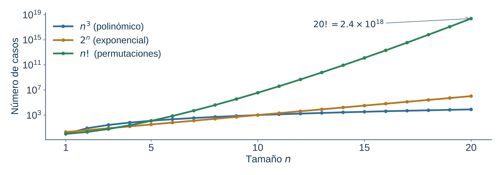

Donde $n! = n \cdot (n-1) \cdots 1$ es el factorial. Crece más rápido que $n^3$ o $2^n$, así que revisar todos los casos deja de ser viable.

---

## Búsqueda completa e incompleta

**Completa**

- Revisa todo el espacio de forma sistemática.
- Encuentra la mejor solución o confirma que no existe.
- Suele ser muy costosa.

**Incompleta**

- Revisa solo una parte del espacio.
- No garantiza la mejor solución ni puede confirmar que no existe.
- Es rápida y se puede controlar con un presupuesto.

Una búsqueda **constructiva** arma la solución desde cero, paso a paso. Una búsqueda **perturbativa** modifica una solución existente para mejorarla.

---

## Qué significan $\mathrm{P}$, $\mathrm{NP}$ y $\mathrm{NP}$-hard

- $\mathrm{P}$: problemas que se resuelven en tiempo polinomial. El tiempo crece como una potencia fija de $n$, como $n^2$ o $n^3$.
- $\mathrm{NP}$ (no determinista polinomial): problemas en que una solución propuesta se puede verificar en tiempo polinomial.
- $\mathrm{NP}$-hard: problemas al menos tan difíciles como los más difíciles de $\mathrm{NP}$. No es obligatorio que estén en $\mathrm{NP}$.
- $\mathrm{NP}$-completo: problemas que están en $\mathrm{NP}$ y además son $\mathrm{NP}$-hard.

Se asume $\mathrm{P} \neq \mathrm{NP}$. Por eso no se conoce un método rápido y exacto para los problemas $\mathrm{NP}$-completos.

---

<!-- _class: compact -->

## El problema del viajante (TSP)

El **TSP** (*Traveling Salesman Problem*, problema del viajante) pide visitar $n$ ciudades una vez y volver a la ciudad de partida con el menor costo. Es un **CSOP** (problema de satisfacción y optimización de restricciones).

**Decisión**

¿Existe una ruta con costo menor o igual que $K$? La respuesta es sí o no. Si se entrega una ruta, su costo se verifica rápido. Es $\mathrm{NP}$-completo.

**Optimización**

¿Cuál es la ruta de menor costo? La respuesta es una ruta, no un sí o no. Es $\mathrm{NP}$-hard.

---

## Justificar una solución aproximada

Una técnica aproximada no se justifica por ser factible. Se justifica por la calidad que alcanza frente a otras opciones.

- **Línea base:** una solución simple, como elegir al azar, para comparar.
- **Presupuesto:** el mismo número de evaluaciones o de tiempo para todos los métodos.
- **Repeticiones:** varias ejecuciones con distintas semillas. Una semilla es el número que fija el azar para repetir una ejecución. Se reportan el promedio y la dispersión.
- **Interpretación:** la diferencia frente a la línea base, en las unidades del costo.

---

## Herramientas de Python

| Herramienta | Qué aporta |
|---|---|
| scikit-fuzzy | Funciones de pertenencia, reglas y defusificación para sistemas difusos |
| DEAP (biblioteca de algoritmos evolutivos en Python) | Operadores y ciclo de algoritmos evolutivos |
| TensorFlow con Keras, o PyTorch | Construcción y entrenamiento de redes neuronales |

Un mismo trabajo de redes neuronales usa una sola de estas bibliotecas.

---

<!-- _class: lead -->

# Sistemas difusos
## Gradualidad, reglas y el método Mamdani

---

<!-- _class: compact -->

## Conjuntos difusos y operaciones

**Conjunto clásico**

Un elemento pertenece (valor $1$) o no pertenece (valor $0$).

**Conjunto difuso**

Cada elemento tiene un grado de pertenencia entre $0$ y $1$, útil para conceptos graduales como "tibio": $\mu_A(x) \in [0, 1]$.

- **Intersección ("y"):** mínimo, $\mu_{A \cap B} = \min(\mu_A, \mu_B)$.
- **Unión ("o"):** máximo, $\mu_{A \cup B} = \max(\mu_A, \mu_B)$.
- **Complemento ("no"):** $\mu_{\bar{A}} = 1 - \mu_A$.

---

## Formas de las funciones de pertenencia

- **Triangular:** sube en línea recta desde $a$ hasta $b$, llega a $1$ en $b$ y baja hasta $c$.
- **Trapezoidal:** igual que la triangular, pero con una meseta de grado $1$ entre $b$ y $c$.
- **Gaussiana:** tiene forma de campana, centrada en $m$, con un ancho $\sigma$.

---

## Variables lingüísticas y reglas

- Una **variable lingüística** es una magnitud, como la temperatura, con términos como baja, confortable o alta. Cada término tiene su propia función de pertenencia.
- Una **regla** tiene la forma SI … ENTONCES: unas condiciones sobre las entradas y una conclusión sobre la salida.
- La "Y" se evalúa con el mínimo, y la "O" con el máximo.

Si una variable tiene $p$ términos y otra tiene $q$, hay $p \cdot q$ combinaciones posibles de condiciones.

---

## Etapas de un sistema Mamdani

El método Mamdani es un sistema difuso con reglas SI … ENTONCES y salida numérica.

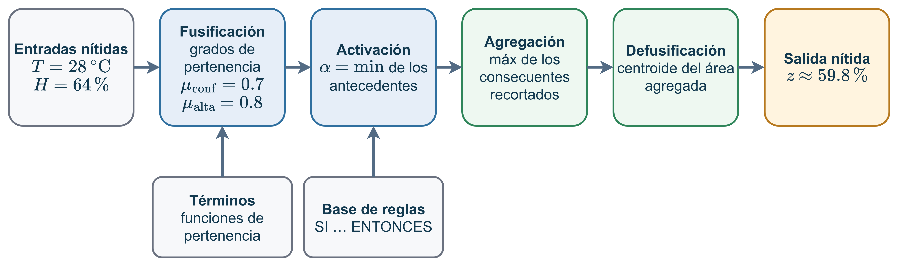

Las entradas exactas se convierten en grados de pertenencia. Las reglas se activan, sus resultados se combinan y el centroide entrega un número.

---

## Fusificación: de número a grados

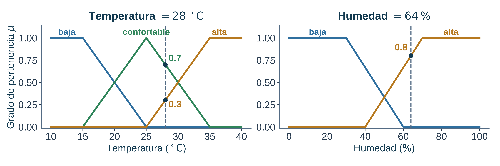

Fusificar es calcular el grado de pertenencia de cada entrada a cada término. Un mismo valor puede pertenecer en distinto grado a dos términos vecinos, como confortable y alta.

---

## Activación de reglas

Cada regla combina sus condiciones con el mínimo. El resultado, $\alpha$, indica qué tanto se cumple la regla. Ese valor recorta el conjunto de salida a esa altura.

Una regla cuya condición tiene grado $0$ tiene $\alpha = 0$ y no aporta a la salida.

---

<!-- _class: compact -->

## Agregación y defusificación

La **agregación** une los conjuntos recortados con el máximo. La **defusificación** convierte el resultado en un número: el **centroide**, el punto que equilibra el área:

$$
z^{*} = \frac{\int z\,\mu(z)\,dz}{\int \mu(z)\,dz}
$$

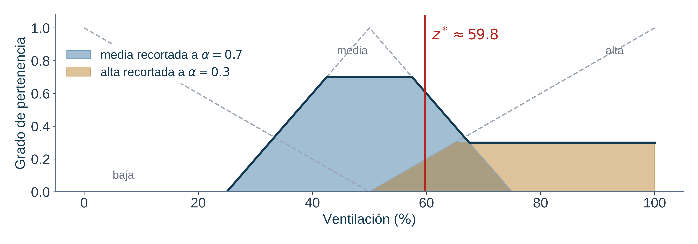

El resultado es un único valor numérico, $z^{*}$, que el sistema entrega como salida.

---

## Validación del sistema difuso

- Revisar el rango y las unidades de cada variable.
- Revisar que cada valor posible de entrada tenga al menos un término con grado mayor que $0$.
- Revisar que las reglas no se contradigan.
- Probar los valores extremos y los bordes del rango.
- Ver si el resultado cambia mucho con otro método de defusificación.

Un sistema difuso se entiende y se defiende solo si sus términos y reglas tienen un significado claro.

---

<!-- _class: lead -->

# Computación evolutiva
## Población, operadores y dos objetivos

---

<!-- _class: compact -->

## El TSTP: TSP con dos objetivos

El **TSP** (problema del viajante) pide visitar $n$ ciudades una vez y volver a la de partida con el menor costo. El **TSTP** (*Traveling Salesman Trolley Problem*) es su variante de dos objetivos. Cada arco, o tramo entre dos ciudades, tiene además un número de personas afectadas.

Se minimizan dos objetivos a la vez:

- La distancia total $L$ de la ruta.
- El total de personas afectadas $M$ en la ruta.

Enumerar todas las rutas no es viable. Por eso se usa una **población** de rutas que se mejora generación tras generación. Los dos objetivos pueden entrar en conflicto.

---

<!-- _class: compact -->

## Conceptos básicos de algoritmos evolutivos

- **Individuo:** un candidato a solución. En el TSTP, una ruta, que se representa como una **permutación**: un orden de todas las ciudades.
- **Población:** conjunto de individuos que se evalúan en una misma generación.
- **Generación:** un ciclo completo de evaluación, selección, cruce, mutación y supervivencia.
- **Fitness:** puntaje que mide la calidad de un individuo. Aquí se minimiza.
- **Padres e hijos:** los padres son los individuos elegidos para reproducirse, y los hijos son sus descendientes.
- **Supervivencia:** decide qué individuos pasan a la siguiente generación. El **elitismo** conserva siempre al mejor.
- **Explotación y exploración:** buscar cerca de las buenas soluciones o en zonas nuevas. Si la explotación es excesiva, se cae en un **óptimo local**, es decir, una solución mejor que sus vecinas, pero no la mejor posible.
- **Criterio de término:** condición que detiene el algoritmo.

---

## Ciclo de un algoritmo evolutivo

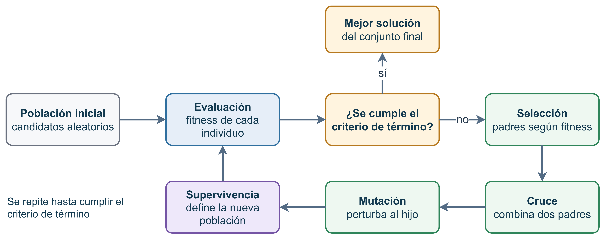

La población se evalúa. Si no se cumple el criterio de término, se generan hijos con cruce y mutación, y la supervivencia forma la nueva población.

Sobre permutaciones, el cruce y la mutación deben conservar un orden válido de ciudades.

---

## Selección y mutación

- **Selección:** elige individuos según su fitness. Por torneo, se enfrentan grupos pequeños y gana el de mejor fitness. Un torneo grande favorece a los mejores, pero reduce la diversidad.
- **Mutación:** cambia un poco un individuo. En una permutación, puede intercambiar dos ciudades o invertir un tramo.
- **Diversidad:** variedad de individuos en la población. La mutación ayuda a mantenerla y evita que todos se parezcan.

Un cruce cualquiera podría repetir ciudades, y eso invalidaría la ruta. Para permutaciones se usa el cruce de orden (OX).

---

<!-- _class: compact -->

## Cruce de orden (OX)

El **cruce de orden** (OX) combina dos padres sin repetir ciudades. Copia un tramo de un padre en las mismas posiciones y completa el resto con el orden del otro padre. Así el hijo sigue siendo una ruta válida.

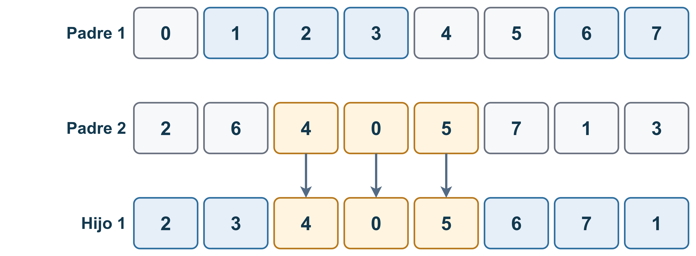

Las posiciones se numeran desde $0$. El tramo de un padre entre dos posiciones se copia al hijo en esas mismas posiciones. Las demás posiciones se llenan con los elementos del otro padre que aún no están, en su orden y desde la posición siguiente al tramo.

---

<!-- _class: compact -->

## Familias de algoritmos evolutivos

| Familia | Representación | Operadores | Aplicación |
|---|---|---|---|
| EP (programación evolutiva) | Vectores | Mutación | Siempre |
| ES (estrategias evolutivas) | Vectores reales | Mutación y cruce | Siempre |
| GA (algoritmo genético) | Cadenas o permutaciones | Cruce y mutación | Con probabilidad |
| GP (programación genética) | Árboles | Subárboles y mutación | Con probabilidad |

En EP y ES, la mutación y el cruce siempre se aplican. En GA y GP se aplican con probabilidad: $p_c$ para el cruce y $p_m$ para la mutación.

Las rutas del TSTP son permutaciones, así que un GA con cruce OX encaja directamente.

---

<!-- _class: compact -->

## Fitness con dos objetivos

El **fitness** resume $L$ y $M$ en un solo puntaje que se minimiza. Cada valor se divide por una referencia para que ambos queden en escalas comparables. El peso $\alpha$, entre $0$ y $1$, decide cuánto pesa cada objetivo:

$$
f_{\alpha} = \alpha \, \frac{L}{L_{ref}} + (1 - \alpha) \, \frac{M}{M_{ref}}
$$

La elección de $\alpha$ debe justificarse. Los valores de referencia $L_{ref}$ y $M_{ref}$ pueden ser, por ejemplo, los promedios de un conjunto de rutas.

---

<!-- _class: compact -->

## Frente de Pareto

Una solución **domina** a otra si es igual o mejor en todos los objetivos y estrictamente mejor en uno. Las que nadie domina forman el **frente de Pareto**.

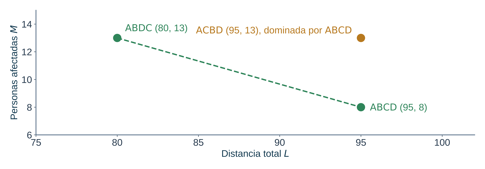

$C$ es dominada por $B$, con el mismo $L$ y menor $M$. $A$ y $B$ no se dominan entre sí.

Con un $\alpha$ fijo, el fitness elige un solo punto del frente.

---

## Término y comparación de algoritmos

El criterio de término puede ser un número de generaciones, un número de evaluaciones de fitness, un tiempo máximo o un número de generaciones sin mejora.

Para comparar dos algoritmos se usan al menos tres criterios: el mejor fitness, el número de evaluaciones, el tiempo, la memoria o la estabilidad entre semillas.

Si la población inicial tiene $\mu$ individuos y cada una de las $G$ generaciones evalúa $\lambda$ hijos, el número de evaluaciones de fitness es:

$$
N_{eval} = \mu + G\,\lambda
$$

Al igual que al justificar una aproximación, ambos algoritmos deben usar el mismo presupuesto de evaluaciones para que la comparación sea justa.

---

<!-- _class: lead -->

# Redes neuronales
## Entrenamiento, particiones y redes convolucionales

---

## Aprendizaje supervisado

Un modelo aprende a partir de ejemplos con respuesta conocida. Recibe una entrada $x$, produce una predicción $\hat{y}$ y ajusta sus parámetros $\theta$ para que $\hat{y}$ se acerque a la respuesta real $y$. La **pérdida** mide qué tan mal predice el modelo, y entrenar significa reducirla.

**Clasificación**

- Salida: una categoría dentro de un conjunto finito de clases.
- Pérdida: entropía cruzada.
- Métricas: exactitud, precisión, recall y $F_1$.

**Regresión**

- Salida: una cantidad numérica.
- Pérdida: error cuadrático medio (MSE).

---

<!-- _class: compact -->

## Particiones de los datos

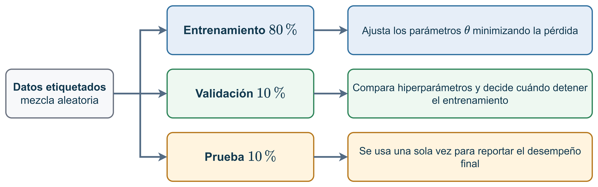

- **Entrenamiento ($80\,\%$):** ajusta los parámetros $\theta$.
- **Validación ($10\,\%$):** compara configuraciones y decide cuándo detener el entrenamiento.
- **Prueba ($10\,\%$):** se usa una sola vez para reportar el desempeño final.

Hay fuga de información si alguna decisión usa datos de prueba. El preprocesamiento se ajusta solo con los datos de entrenamiento.

---

## Matriz de confusión

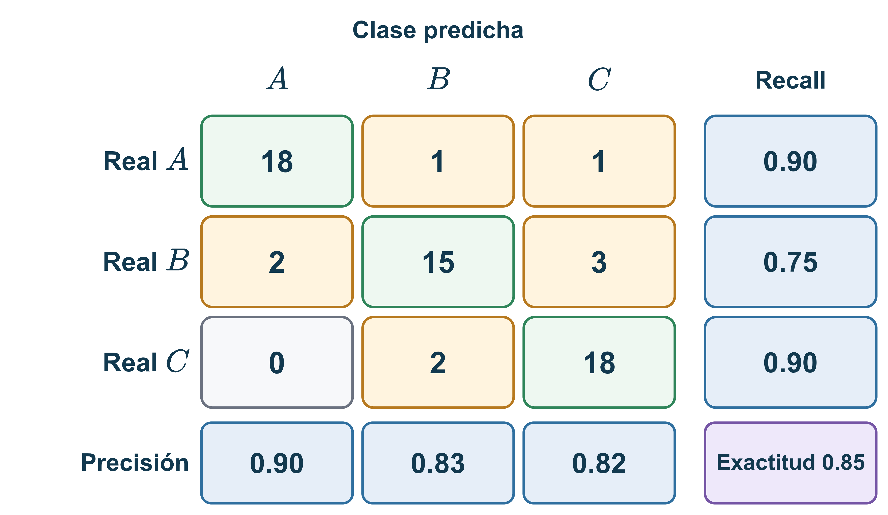

Las filas son la clase real y las columnas la clase predicha. La diagonal reúne los aciertos. Los errores quedan fuera de la diagonal y muestran qué clase se confunde con cuál.

---

<!-- _class: compact -->

## Métricas de clasificación

- **Exactitud:** proporción de aciertos sobre el total.
- **Precisión:** de los casos predichos como una clase, qué proporción era correcta.
- **Recall** (sensibilidad): de los casos reales de una clase, qué proporción se detectó.
- **$F_1$:** promedio armónico de $P$ y $R$, con $F_1 = \dfrac{2PR}{P+R}$. Es alto solo si ambos son altos.

Con clases desbalanceadas, la exactitud puede parecer alta aunque una clase casi no se detecte.

---

## Neurona y red multicapa

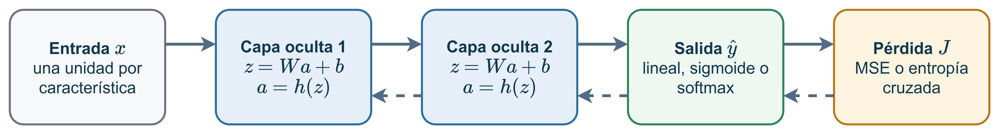

Cada capa calcula $z = W a + b$, con pesos $W$, sesgos $b$ y entradas $a$ de la capa anterior. Luego aplica una activación $a = h(z)$. Una red multicapa (MLP, *multilayer perceptron*) apila varias de estas capas.

La línea continua muestra la predicción. La línea punteada muestra cómo el error se devuelve para ajustar los pesos. Sin una activación no lineal, varias capas equivalen a una sola.

---

## Funciones de activación

- **ReLU** (*rectified linear unit*): $h(z) = \max(0, z)$. Se usa en capas ocultas.
- **Sigmoide**: $h(z) = \dfrac{1}{1 + e^{-z}}$, con valores entre $0$ y $1$. Se usa para clasificación binaria.
- **Tangente hiperbólica**: valores entre $-1$ y $1$.
- **Softmax**: convierte los puntajes de $K$ clases en probabilidades que suman $1$. Se usa para clasificación con varias clases.
- **Lineal**: $h(z) = z$. Se usa en la salida de regresión.

La activación de salida y la pérdida se eligen juntas. Softmax se combina con entropía cruzada, y la salida lineal con MSE.

---

<!-- _class: compact -->

## Softmax y entropía cruzada

Softmax transforma los puntajes $z_k$ en probabilidades:

$$
p_k = \frac{e^{z_k}}{\sum_j e^{z_j}}
$$

La entropía cruzada mide la pérdida como $L = -\ln p_y$, donde $p_y$ es la probabilidad que el modelo asigna a la clase correcta. Cuanto mayor sea esa probabilidad, menor es la pérdida.

---

<!-- _class: compact -->

## Entrenamiento por gradiente

Los parámetros se actualizan con:

$$
\theta \leftarrow \theta - \eta \, \nabla_\theta J
$$

- $J$: pérdida. $\nabla_\theta J$ indica hacia dónde sube la pérdida, así que el paso va en sentido contrario.
- $\eta$: tasa de aprendizaje, es decir, el tamaño del paso.
- **Retropropagación:** calcula ese gradiente capa por capa, desde la salida hacia atrás.
- **Minilote:** grupo pequeño de ejemplos para cada paso. **Época:** una pasada completa por todos los datos.
- **SGD** (descenso por gradiente estocástico) usa el gradiente directo. **Adam** ajusta el tamaño del paso para cada parámetro.

---

<!-- _class: compact -->

## Subajuste y sobreajuste

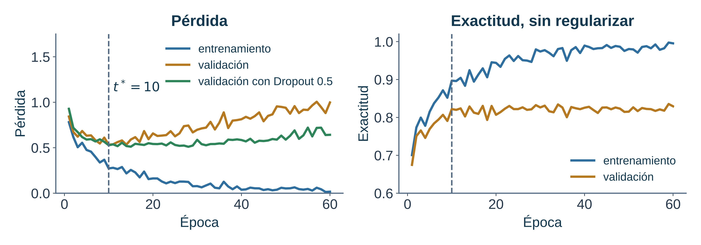

Si el modelo memoriza el entrenamiento, su pérdida de validación sube. Eso es **sobreajuste**. Si ni siquiera aprende bien el entrenamiento, es **subajuste**.

Cuando la pérdida de validación deja de bajar y empieza a subir, el modelo ya se está sobreajustando.

---

## Regularización

- **Penalización $L_2$:** suma al costo $\lambda \sum_i w_i^2$, lo que mantiene los pesos pequeños.
- **Dropout:** apaga neuronas al azar durante el entrenamiento, con probabilidad $p$. Así la red no depende de pocas neuronas.
- **Parada temprana:** detiene el entrenamiento en la época $t^*$, donde la pérdida de validación es mínima.

---

## Red convolucional (CNN)

Una red convolucional (CNN, *convolutional neural network*) recorre la imagen con filtros pequeños para detectar patrones locales, como bordes. La **agrupación máxima** reduce el tamaño de la imagen y deja el valor más alto de cada bloque. Al final, las capas **densas** clasifican.

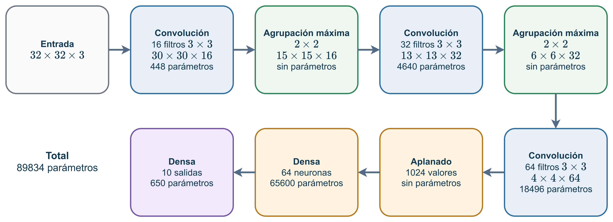

Cada filtro se reutiliza en toda la imagen, por eso la CNN tiene menos parámetros que una red totalmente conectada.

---

<!-- _class: compact -->

## Diseño experimental y comparación

- Se usan las mismas particiones y una sola biblioteca para todos los modelos.
- La partición de prueba se usa una vez, al final.
- Los modelos se comparan con varias semillas, no con una sola ejecución.

Una diferencia pequeña entre dos modelos puede deberse al azar. Por eso se reportan varias ejecuciones con su dispersión.

---

## Referencias

1. L. A. Zadeh, "Fuzzy Sets", *Information and Control*, 1965.
2. L. A. Zadeh, "Fuzzy Logic, Neural Networks, and Soft Computing", *Communications of the ACM*, 1994.
3. A. M. Turing, "On Computable Numbers, with an Application to the Entscheidungsproblem", 1936.
4. S. A. Cook, "The Complexity of Theorem-Proving Procedures", 1971.
5. R. M. Karp, "Reducibility Among Combinatorial Problems", 1972.
6. T. J. Ross, *Fuzzy Logic with Engineering Applications*, 3.ª ed., Wiley, 2010.
7. D. E. Goldberg, *Genetic Algorithms in Search, Optimization, and Machine Learning*, Addison-Wesley, 1989.
8. I. Goodfellow, Y. Bengio y A. Courville, *Deep Learning*, MIT Press, 2016.
